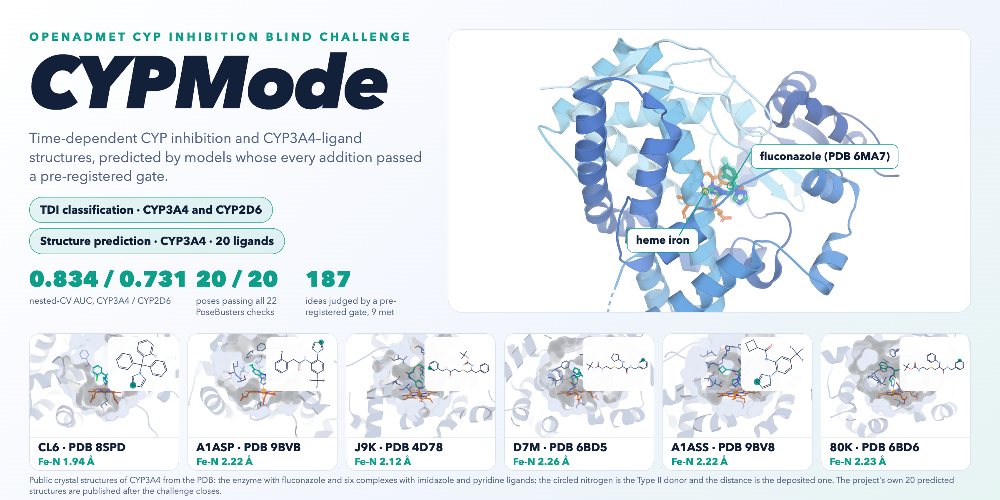
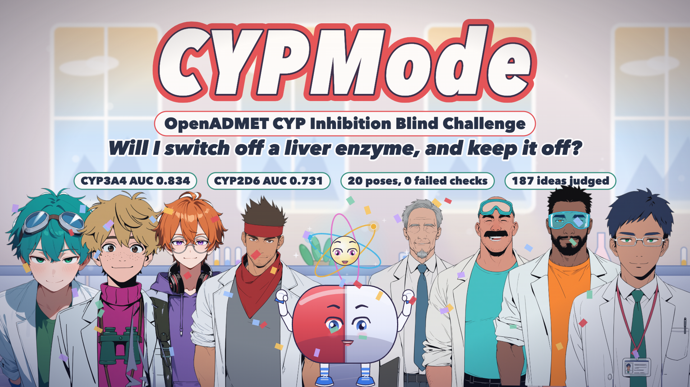

# CYPMode

<!-- held-back:card
<p align="center">
  <picture>
    <source media="(prefers-color-scheme: dark)" srcset="docs/card/cypmode_card-dark.png">
    
  </picture>
</p>
<p align="center"><a href="https://mohamedtalaat-gif.github.io/CYPMode/card/">Open the interactive card</a>: rotate the enzyme, load each of the six complexes and read the iron&ndash;nitrogen distance measured on the coordinates. GitHub does not run scripts in a README, so the interactive version is a page of its own.</p>
held-back:card-end -->

## What CYPMode is

**CYPMode is a set of reproducible predictors, with the evidence behind them, for one question: will a drug-like molecule switch off a cytochrome P450 enzyme, and does it keep it off?**
Cytochrome P450 enzymes such as CYP3A4 and CYP2D6 clear most medicines from the body. A compound can block an enzyme while it is present (direct inhibition) or after the enzyme has
processed it (time-dependent inhibition, TDI: a reactive product stays bound), and TDI is the form that makes drug-drug interactions dangerous. Many inhibitors bind the iron of the
enzyme's heme through a nitrogen atom (a Type II ligand), which is also why the geometry of a bound compound carries information.

The repository answers the question for the two tasks of the OpenADMET CYP Inhibition Blind Challenge:

- **TDI classification (CYP3A4 and CYP2D6).** For each of the 750 blinded compounds: is it a time-dependent inhibitor? The label is a function of two measured potencies: it is positive
  exactly when the pIC50 after pre-incubation with the enzyme exceeds the direct-inhibition pIC50 (floored at 4) by more than log10 2, a factor of two. The rule was reproduced exactly from the
  training file.
- **CYP3A4 structure prediction.** For each of 20 ligands: the three-dimensional complex with the enzyme (Boltz-2 co-folding, with an iron-nitrogen restraint for ligands that have a Type II
  donor), every pose checked under the organisers' own PoseBusters call.

**How it works.** For TDI, label-free features (fingerprints, descriptors, motif flags, GFN2-xTB physics) feed a stack of diverse models; the blend is cut by transferring the expected rate of
positive calls of the scored population. CYP2D6 has one more candidate, a selection-aware model, because compounds were not tested on every enzyme at random. For structures, a recipe of restraint,
pose-validity and margin rules in which every lever was decided by a gate on crystal-structure benchmarks.

**What is different here.**

1. *Honest evaluation.* Models are judged by nested cross-validation that reproduces the scored population (similarity to the blinded set, test prevalence, only confidently labelled
   compounds), with every selection step inside the loop, and compared with the corrected resampled t test of Nadeau and Bengio.
2. *Pre-registered gates.* The rule an idea must pass is written down before the idea is tested. An idea that fails stays in a ledger of negative results; it is not tuned until it passes. The
   ledger and its counts are generated from the run logs: [NEGATIVE_RESULTS.md](NEGATIVE_RESULTS.md) and [METHOD_REPORT.md](METHOD_REPORT.md).
3. *Generated and audited.* The reports are produced by code from the logs; an automated audit runs twice and must agree byte for byte; a leakage audit checks that no test label and no
   board-derived label is used.
4. *Uncertainty by construction.* Reliability tiers by similarity to the training data (`applicability_domain.py`), probabilities calibrated on inner out-of-fold scores, and the disagreement of the
   committee, reported with every prediction.

**What it does not claim.** Cross-validation estimates are not the challenge score: the challenge scores hidden labels, and its test set is closer to the training set than a cross-validation
fold is. A predicted structure is a model, not a measurement. The numbers reported here come from nested cross-validation on the training data and from checks of the predicted coordinates. One piece of aggregate information about the hidden labels is used: the positive rate of the scored set, which the public leaderboards make recoverable from the accuracy, precision and recall they publish (it weights the yardstick and sets the call rate); no label of any compound and no probing submission is used, and the method report lists it as a limitation.

**Where to look next.** [METHOD_REPORT.md](METHOD_REPORT.md) (what was done, with every gate and number), [NEGATIVE_RESULTS.md](NEGATIVE_RESULTS.md) (what did not work), [audit/AUDIT_REPORT.md](audit/AUDIT_REPORT.md)
(what was checked), `notebooks/` (the teaching notebook, from first principles) and the architecture sections below.

<!-- held-back:film
## The film

A 6.5-minute animated film explains the project from the question to the results, scene by scene, with nine characters who each stand for one part of the work (the assay, the data scout, the
features, the stack, the statistician, the physics, the pretrained models, the structure track and the audit). Every number on screen is read from this repository's own files, every molecule and pocket is
drawn from real coordinates, and the voices are synthesised (Kokoro-82M). Click the picture to play the film (H.264, `docs/video/cypmode_overview_web.mp4`); the storyboard and the build are in
[`docs/video/STORYBOARD.md`](docs/video/STORYBOARD.md).

<p align="center">
  <a href="docs/video/cypmode_overview_web.mp4">
    
  </a>
</p>

held-back:film-end -->

## Origin of the project and the two parts of this file

CYPMode began as a heme-coordination motif screen for CYP450 inhibitors with a structure-based check (described in the second part of
this file). It now also contains an entry for the OpenADMET CYP blind challenge:

- **TDI classification** (time-dependent inhibition of CYP3A4 and CYP2D6): a label-process-aware model evaluated with a nested,
  selection-honest cross-validation on the same population the challenge scores.
- **CYP3A4 structure prediction**: Boltz-2 (and optionally OpenFold3) co-folding with a gated pose-selection recipe.

Every addition to a model passes through a pre-registered gate (corrected resampled t, both confidence cut-offs, alone and inside the
assembled stack). Results are generated by code from the run logs: [METHOD_REPORT.md](METHOD_REPORT.md),
[NEGATIVE_RESULTS.md](NEGATIVE_RESULTS.md) and [audit/AUDIT_REPORT.md](audit/AUDIT_REPORT.md). [SUBMISSION_CHECKLIST.md](SUBMISSION_CHECKLIST.md)
lists every planned experiment with its gate and the queue job that runs it (`python -m cypmode.audit.checklist --status` prints what is
done, running and queued).

## Architecture: TDI classification

```
                         SMILES  (training compounds + the blinded test structures; features are label-free)
                            |
        +-------------------+----------------------------+
        v                                                v
 2D FEATURE BLOCKS                              PHYSICS BLOCKS (GFN2-xTB via tblite, own process)
 Morgan counts, RDKit descriptors,              tier A   molecule: conformer ensemble, vertical IP / EA, hardness,
 MACCS, Avalon, ErG, torsion,                              solvation, shape
 feature-Morgan, motifs, alerts                          atom: charges, Fukui f- / f+, C-H abstraction energy,
                                                           proton affinity of N atoms, SASA
 opt-in blocks:                                          site: per-role statistics (benzylic, alpha-N, azole N ...)
 CheMeleon embeddings (frozen, 64 PCs)                   pharmacophore: heme-binder <-> oxidation-site distances
                                                tier B   Boltzmann-weighted conformers, locally relaxed hydrogen abstraction
                                                compact  the 20 physics columns with the largest gain, chosen from the
                                                         training rows of every task (evaluation rows never pick columns)
        |                                                |
        +-------------------+----------------------------+
                            v
          MODEL MEMBERS  (nested CV; a member enters the stack only when its gate is met)
 +----------------------+---------------------+--------------------------+--------------------------+
 | A  Classifiers       | B  SAR-aware pairs  | C  Label-process model   | D  Selection-aware       |
 | LightGBM (A, A+fps,  | each compound vs    | committee of two-arm     | CYP2D6 only              |
 | A+physics, A+compact | its nearest labelled| regressors (TDI arm and  | P(label) =               |
 | physics, A+arms of   | neighbours: deltas  | direct arm, floor-clipped| P(hit) x P(label | hit)  |
 | the other isoforms), | of descriptors and  | at 4, noise-weighted)    | gate fitted on the       |
 | ExtraTrees, RF,      | of physics; matched | -> exact P(shift >       | all-isoform panel block  |
 | kNN / SVM (Tanimoto),| molecular pairs     | log10 2) and expected    | (4,352 compounds); the   |
 | two-arm regressors   |                     | improvement              | physics block is an      |
 |                      |                     |                          | optional input of its    |
 |                      |                     |                          | gate and label models    |
 +----------+-----------+----------+----------+------------+-------------+------------+-------------+
            +----------------------+-----------------------+--------------------------+
                                   |   optional training weights: similarity to the test structures
                                   |   (density ratio, tempered); measurement-variance weights in C
                                   v
            STACK    logistic blend of the members' inner out-of-fold scores (L1 / L2, chosen by inner CV)
                                   v
            CYP2D6 only   HEDGED BLEND  rank blend of the hits-only stack and the selection-aware stack, judged across
                          regimes of the share of never-promoted compounds in the scored set (label-shift estimate of that
                          share from the test structures: test_nonhit_share); written as a candidate file only if its
                          minimax gate is met
                                   v
            CALIBRATION   raw, Platt or isotonic, whichever meets ECE <= 0.05 and slope in [0.8, 1.2]
                                   v
            DECISION      positive calls = a pre-declared multiple of the scored prevalence (rate transfer),
                          the top-scoring compounds of the test file are called
                                   v
            candidate files (schema checked with the challenge portal's own rules) + SHA-256 manifest
```

How the sketch is evaluated and assembled:

- **Nested evaluation.** 5 outer folds x 3 repeats; every selection (members, stack weights, calibration, threshold rule) happens inside
  the training part of each outer fold. Comparisons use the corrected resampled t of Nadeau and Bengio with Holm adjustment.
- **Gate.** An addition counts only when it beats its reference with corrected p < 0.05 at both confidence cut-offs, alone and inside the
  assembled stack (`final_tdi_build.py` reads the verdict lines and applies one fixed rule; nothing is chosen by hand).
- **Replicate.** The physics additions are re-judged with 10 outer folds (`--design 10`, variance factor 0.144 instead of 0.317); an addition
  counts as replicated only if the 10-fold gate is met and the 5-fold sign is positive (`replicate_verdict.py`).
- **Reproduction.** `scripts/reproduce_tdi.sh` rebuilds the candidate files from the raw files and checks them against the portal rules.

Label rule (recovered from the data and reproduced exactly): `s = t - max(d, 4) > log10 2`, with `t` the TDI-condition pIC50 and `d`
the direct-inhibition pIC50. Evaluation weights follow similarity to the test structures, the estimated test prevalence and the
confidence of each label (`|s - log10 2| / sd(s)` at two cut-offs).

### Final stack and verdicts

<!-- generated:final-stack begin (python -m cypmode.audit.docs_state; the text between the markers is rewritten) -->
Final stack per isoform, from the nested cross-validation on the population the challenge scores (z0 is the confidence cut-off of the label weights; MCC is at the rate transferred from the scored prevalence):

| isoform | stack | members | groups added by a met gate | AUC (z0 1.0) | AUC (z0 1.96) | MCC (z0 1.0 / 1.96) |
| --- | --- | --- | --- | --- | --- | --- |
| CYP3A4 | default+neural | 26 | ['neural'] | 0.828 | 0.855 | 0.461 / 0.513 |
| CYP2D6 | default | 23 | none | 0.731 | 0.754 | 0.167 / 0.204 |

Members of the default stack: k-nearest neighbours (Tanimoto) (3), support vector machine (Tanimoto kernel) (3), LightGBM classifier (11), extremely randomised trees (1), random forest (1), LightGBM regressor of the arm shift (2), LightGBM regressors of the two arms (2); 23 members in all.
<!-- generated:final-stack end -->

<!-- generated:gate-verdicts begin (python -m cypmode.audit.docs_state; the text between the markers is rewritten) -->
Every addition was judged by a rule fixed before its result. 176 gate verdicts from 57 experiments: 10 MET and 166 NOT MET. The gates that were met: aux_neural, aux_neural_f10, bond restraint, contact restraint, force-field relaxation of poses, negative control (permuted labels), pool gates repeated with OpenStructure's yardstick, replicates with 10 outer folds. A MET verdict on a negative control means that the pipeline gives chance on permuted labels, as it must. An addition to the TDI stack counts only when its gate is met alone and inside the stack; groups added to the final stack: CYP3A4: ['neural']; CYP2D6: none.

<details><summary>All verdicts</summary>

| experiment | TDI CYP3A4 | TDI CYP2D6 | structure |
| --- | --- | --- | --- |
| Emax of both arms as a predicted block | NOT MET | NOT MET | - |
| Monroe (GRIT) embeddings | NOT MET | NOT MET | - |
| PXR-induction readings as a predicted block | NOT MET | NOT MET | - |
| SAR pair transfer | NOT MET | NOT MET | - |
| SAR pair transfer with physics | NOT MET | NOT MET | - |
| TabICL in the stack | NOT MET | NOT MET | - |
| TabICL on Monroe embeddings | NOT MET | NOT MET | - |
| TabICL on frozen CheMeleon embeddings | NOT MET | NOT MET | - |
| TabPFN in the stack | NOT MET | NOT MET | - |
| TabPFN on frozen CheMeleon embeddings | NOT MET | NOT MET | - |
| aux atomjepa | NOT MET | NOT MET | - |
| aux atomjepa head | NOT MET | NOT MET | - |
| aux ext adme | NOT MET | NOT MET | - |
| aux ext cont | NOT MET | NOT MET | - |
| aux ext tox | NOT MET | NOT MET | - |
| aux neural | MET | NOT MET | - |
| aux neural f10 | MET | - | - |
| basic-centre block (protonation states, centre classes) | NOT MET | NOT MET | - |
| bond restraint confirmed on new ligands | - | - | NOT MET |
| committee label-process model | NOT MET | NOT MET | - |
| compact physics block | NOT MET | NOT MET | - |
| compact physics block, replicate with 10 outer folds | NOT MET | NOT MET | - |
| compounds without a direct curve | NOT MET | - | - |
| consensus of poses across a chemical series | - | - | NOT MET |
| cross-isoform transfer of the assay arms | NOT MET | NOT MET | - |
| expected-improvement sampling of poses | - | - | NOT MET |
| exploratory atomjepa head f10 | NOT MET | - | - |
| force-field relaxation of poses | - | - | MET |
| frozen CheMeleon embeddings | NOT MET | NOT MET | - |
| gate-shift features | NOT MET | NOT MET | - |
| hedged blend of the hits-only and the selection-aware stacks | - | NOT MET | - |
| heme-frame prior over poses | - | - | NOT MET |
| matched-molecular-pair transfer | NOT MET | NOT MET | - |
| minimum Bayes risk and restraint judged by LDDT-PLI (exploratory) | - | - | NOT MET |
| minimum Bayes risk selection and engine consensus | - | - | NOT MET |
| multitask network in the stack | NOT MET | NOT MET | - |
| multitask network with the screen and Emax as auxiliary heads | NOT MET | NOT MET | - |
| negative control (permuted labels) | MET | MET | - |
| non-negative stacking | NOT MET | NOT MET | - |
| our LDDT-PLI against OpenStructure's | - | - | NOT MET |
| physics block tier A, replicate with 10 outer folds | NOT MET | NOT MET | - |
| physics block tier B, replicate with 10 outer folds | NOT MET | NOT MET | - |
| physics block, tier A | NOT MET | NOT MET | - |
| physics block, tier B | NOT MET | NOT MET | - |
| physics, pharmacophore and combined pose terms | - | - | NOT MET |
| plain Chemprop in the stack | NOT MET | NOT MET | - |
| pool gates repeated with OpenStructure's yardstick | - | - | mbr_selection_ost NOT MET; engine_consensus_ost NOT MET; ei_sampling_ost NOT MET; heme_frame_prior_ost NOT MET; pose_physics_ost NOT MET; pose_pharmacophore_ost NOT MET; pose_combined_ost NOT MET; series_consensus_ost NOT MET; restraint_bond_ost MET; restraint_contact_ost MET; pilot_conformers_ost NOT MET; pilot_cryoem_ost NOT MET; pilot_seeds_ost NOT MET; mbr_lddt_exploratory_ost NOT MET; restraint_bond_lddt_exploratory_ost NOT MET; mbr_on_restrained_lddt_exploratory_ost NOT MET |
| replicates with 10 outer folds | replicate physics NOT MET; replicate physics_compact NOT MET; replicate physics_b NOT MET; replicate neural MET | NOT MET | - |
| restraint confirmation repeated with OpenStructure's LDDT-PLI | - | - | NOT MET |
| restraints and pose-diversity pilots | - | - | restraint_bond MET; restraint_contact MET; pilot_conformers NOT MET; pilot_cryoem NOT MET; pilot_seeds NOT MET |
| selection-aware CYP2D6 model with physics | - | NOT MET | - |
| selection-aware CYP2D6 model with the screen | - | NOT MET | - |
| selection-aware model, second version | - | NOT MET | - |
| single-concentration screen as a predicted block | NOT MET | NOT MET | - |
| softmax-temperature selector | NOT MET | NOT MET | - |
| test-likeness weighting | NOT MET | NOT MET | - |
| two-arm regressors, floor-clipped | NOT MET | NOT MET | - |

</details>
<!-- generated:gate-verdicts end -->

## Architecture: structure track

```
 ligand SMILES + CYP3A4 sequence (UniProt P08684, precomputed MSA)
        |
        v
 Boltz-2 co-folding  <---- optional levers, each used only when its gate is met ------+
        |                  Fe-donor bond / contact restraint (Type II donors)         |
        |                  crystal and cryo-EM conformer templates, seeds, step scale |
        |                  OpenFold3 as a second engine (low-memory chunking)        |
        v                                                                            |
 pose pool per ligand  <---------------------------------------------------------+
        |
        v
 PoseBusters validity filter -> selection among valid poses, mean rank of:
        expected LDDT-PLI (minimum Bayes risk)                                        (selection_validation)
        physics / molecule terms (match to the xTB conformer ensemble and its         each term enters
          energy, burial, contacts, clashes)                                           only when its
        pharmacophore terms (Fe-donor distance error, oxidation site in the           gate is met
          substrate window)                                                           (pose_awareness)
        SAR term (core agreement with the poses of the ligand's analogs, maximum
          common substructure after superposing the C-alpha atoms)                    (series, series_consensus)
        heme-frame pose prior from 148 crystal ligands                                (heme_frame_prior)
        |
        v
 extra samples allocated by pool disagreement (optional, ei_sampling) -> one pose per ligand -> zip
        |
        v
 final_recipe.py   reads the gate verdicts, applies one fixed mapping to the recipe, runs the 20 official ligands, validates with the
                   portal's rules and lists, per ligand, the donor status, the closest analog and the measured CYP3A4 values of
                   the same compound in the TDI training file
```

Benchmark for every structure gate: crystal-anchored CYP3A4 complexes (true ligand RMSD of the picked pose, PoseBusters validity),
plus a series benchmark of analog pairs that have crystal structures. The earlier Boltz-only zip stays untouched as the fallback.

### Final recipe

<!-- generated:structure-recipe begin (python -m cypmode.audit.docs_state; the text between the markers is rewritten) -->
How the 20 poses of the submitted zip were chosen, from the verdicts of the gates and the recipe that reads them (`cypmode/validation/final_recipe.py`):

- restraint 'bond': gate MET
- diversity levers: none (no pilot gate MET)
- Boltz only: engine_consensus not MET
- selection 'first_valid': mbr_selection not MET, so the model's own ranking among valid poses is kept; for a ligand with a Type II donor the restrained run is read first (the pick the restraint gate measured)
- extra samples allocated uniformly: ei_sampling not MET
- margin: among valid poses only those with a relative distance to the receptor of at least 0.8 under the scorer's own PoseBusters call are eligible (else the largest margin)
- force-field relaxation of the chosen poses in the frozen pocket (gate met on 30 crystal-anchored ligands): 20 of 20 poses replaced under a rule fixed before the use (both poses pass the 22 checks, the smallest relative distance to the receptor rises and stays at or above 0.8, the ligand moves by at most 1.0 A, a coordinated iron-nitrogen distance changes by at most 0.2 A); smallest relative distance 0.801 to 0.850
<!-- generated:structure-recipe end -->

## Repository map

| Path | Content |
| --- | --- |
| `cypmode/challenge/` | TDI engine: feature store, nested cross-validation harness (`nested.py`, `nested_runners.py`), label confidence, library blocks, physics blocks (`physics_block.py`, `physics_tierb.py`, `population_physics.py`), SAR models (`pair_transfer.py`, `mmp_transfer.py`), label-process committee, cross-isoform arm transfer (`xiso_transfer.py`), selection-aware models (`selection_aware_v2.py`, `hedged_blend.py`, `test_nonhit_share.py`), frozen embeddings, calibration, `replicate_verdict.py`, `final_tdi_build.py` |
| `cypmode/validation/` | structure tools: input builder, Boltz-2 / OpenFold3 runners, PoseBusters checks, pose pools, templates (`conformers.py` crystal, `cryoem_templates.py` cryo-EM), selection (`selection_validation.py`), gates (`structure_gates.py`), pose terms (`pose_awareness.py`), analog series (`series.py`, `series_consensus.py`), heme-frame prior, expected-improvement sampling, `final_recipe.py` |
| `cypmode/audit/` | automated audit report, gate ledger, checklist consistency check (`checklist.py`), method-report generator (`method_report.py`), public-readiness scan (`public_readiness.py`) |
| `cypmode/metrics/`, `cypmode/data/` | the original motif screen and panel loaders |
| `queue/`, `scripts/` | the permanent job queue (`queue/jobs/NNN_*.sh`, helpers in `queue/lib.sh`), runner, memory / battery guards (`scripts/guards.sh`), reproduction and audit scripts, the low-memory OpenFold3 launcher (`scripts/run_openfold_lowmem.py`) |
| `notebooks/` | the notebook `cypmode_notebook`: the teaching text and the laboratory notebook of the project, built from `notebooks/parts/` by `python -m notebooks.build_notebook` (ipynb, html, pdf) |
| `environment/` | pinned package lists for the Python environments (main, torch and explorer) with checksums |
| `explorer/`, `cypmode/explorer/` | the interactive explorer of the finished results, a reactive marimo notebook that reads only a small public data bundle (`explorer/public`, built by `cypmode/explorer/data.py`): the gate ledger, what a different threshold would have let through, the selection rules fold by fold, the benchmark poses and the stored out-of-fold predictions |
| `tests/` | test suite (the torch and tblite files run in their own processes, see below) |
| `data/` | inputs, caches and outputs of both tracks |
| `app.py` | Streamlit app: the original screen and a TDI results tab that reads the generated final report and gate ledger |

## Quick start

```bash
python3 -m venv .venv && source .venv/bin/activate
pip install -e ".[challenge,validate]"
python -m pytest tests -q                       # main suite
python -m pytest tests/test_quantum_pharmacophore.py tests/test_physics_block.py tests/test_physics_tierb.py -q   # tblite, own process
bash scripts/run_audit.sh                       # audit report, generated twice and compared byte for byte
bash scripts/reproduce_tdi.sh                   # raw files -> validated TDI candidate files (hours, resumable)
bash scripts/queue_start.sh                     # start the permanent queue; bash scripts/queue_status.sh to inspect it
python -m cypmode.audit.checklist --status      # what is done, running, queued
python -m cypmode.audit.method_report           # regenerate METHOD_REPORT.md and NEGATIVE_RESULTS.md from the logs
python -m cypmode.audit.public_readiness        # scan for private paths, credentials, large files, third-party text
bash scripts/mirror_check.sh                      # after a push: remote branch, HEAD and working tree are identical
python -m notebooks.build_notebook              # rebuild the notebook (ipynb, html, pdf)
bash scripts/explorer.sh run                    # the interactive explorer (needs .venv-marimo, see the header of the script); also edit, html, ipynb and wasm
```

Torch-based tests (`tests/test_multitask.py`, `tests/test_chemberta_features.py`) and the tblite tests must not share a process with
LightGBM; `CONTRIBUTING.md` explains why and how each is run.

## Credits and sources

Published sources are listed in [CITATION.cff](CITATION.cff) and in section 14 of [METHOD_REPORT.md](METHOD_REPORT.md).
How to cite this work, what counts as using it and what the licence can and cannot do are in [USE_AND_CITATION.md](USE_AND_CITATION.md).

---

# Original scope: mode-aware reinterpretation of TDC's CYP450 inhibition benchmarks

## Problem

[Therapeutics Data Commons](https://tdc.hub.biolib.com) ships binary
inhibitor/non-inhibitor labels for the five major cytochrome P450 isoforms
(`CYP1A2_Veith`, `CYP2C9_Veith`, `CYP2C19_Veith`, `CYP2D6_Veith`,
`CYP3A4_Veith`, from Veith et al., *Nat. Biotechnol.* 2009), and every
ADMET model trained on them inherits the same blind spot: the label says
*whether* a compound inhibits a CYP, not *how*. Pharmacologically, that
"how" is the difference between Type I inhibition (reversible, substrate
in the active site, the heme's axial water stays put) and Type II
inhibition (a nitrogen lone pair coordinates directly to the heme iron,
displacing that water) — a much tighter, often far more clinically
significant interaction (de Groot, *Drug Discov. Today*, 2006, 11:601-606).
A binary "1" collapses both into the same bit.

Checked this against the data itself, not just the framing: across all
five isoforms, only 26-31% of TDC's labeled inhibitors carry any
heme-coordinating motif at all (`cypmode/data/panel.py`,
`summarize_panel()` — CYP1A2 28.1%, CYP2C9 30.0%, CYP2C19 28.2%, CYP2D6
26.5%, CYP3A4 30.6%, n=2,514-5,829 labeled inhibitors per isoform). Most
of the panel's "inhibitor" label describes something a motif screen
wouldn't expect to coordinate the heme directly — which is exactly the
information a plain binary label discards.

This project is scoped as a direct extension of a newly solved CYP3A4
cryo-EM structure paper (ketoconazole, ritonavir, azamulin, and
vardenafil bound), not a general re-annotation of the whole panel by
assertion: `cypmode/validation/structures.py` checks the motif screen's
calls against physics-based structure prediction (Boltz-2) for exactly
the four compounds that paper solved structures for, and no others —
full-panel physics-based validation across ~62,000 compounds would take
on the order of 2,000 GPU-hours on this hardware, which isn't a rerun of
that paper's method, it's a different, unvalidated claim.

## What's here

- `cypmode/metrics/motifs.py` — a fast RDKit/SMARTS screen for the classic
  heme-coordinating substructures (imidazole, triazole, pyridine,
  thiazole), in the structural-alert tradition of Leach, *Molecular
  Modelling: Principles and Applications* (2001, ch. 12, section 12.2).
  Seconds for the whole panel, not a mechanism predictor on its own.
- `cypmode/data/panel.py` — loads and mechanism-annotates TDC's five-isoform
  CYP inhibition panel.
- `cypmode/data/octant_benchmark.py` — checks the motif screen against a
  different, independent axis: real CYP3A4 dose-response potency from a
  ~1,200-compound diversity-library screen (OpenADMET/Octant), rather than
  TDC's binary labels or the four structurally-validated reference
  compounds. See Independent large-N potency check, below.
- `cypmode/validation/build_input.py` — builds a Boltz-2 YAML input (protein
  + heme, covalently bonded) for any ligand SMILES, and locates the
  coordinating cysteine on any given protein sequence rather than assuming
  a fixed residue number. Neither of the original four reference inputs
  was generated by code — this replaces that gap.
- `cypmode/validation/pipeline.py` — `run_structural_validation(name,
  smiles)`: one call from a SMILES string to a coordination result, for a
  new compound the four reference inputs know nothing about. Wraps
  build_input, an actual `boltz predict` subprocess run (tens of minutes,
  not skipped or faked), and structures.py's summary in one function
  instead of three separate manual steps.
- `cypmode/validation/structures.py` — parses Boltz-2's predicted structures
  (heme explicitly modeled and covalently bonded to the real axial
  cysteine, not left out) and measures the heme iron's distance to
  whichever ligand nitrogen(s) actually match a Type II motif — not just
  the geometrically closest one, which isn't always the same atom (see
  Methodology note, below).
- `cypmode/validation/batch.py` — runs `run_structural_validation` across a
  whole compound set (name -> SMILES) in one call, checkpointing results
  after every compound so a run spanning hours survives interruption, and
  isolating one compound's failure from the rest of the batch.
- `cypmode/validation/build_summary.py` — regenerates
  `data/structure_track/outputs/validation_summary.json` by discovering finished runs
  under `data/structure_track/outputs/out/` and reading each one's SMILES back out of
  its own input YAML; see Reproducing this, below.
- `app.py` — a Streamlit tool: paste a compound, get the motif call and,
  for the four reference compounds, the structural check.
- `docs/figures/generate_validation_figure.py` — regenerates the Fe-N bar
  chart below (light and dark variants) from
  `data/structure_track/outputs/validation_summary.json`; needs `pip install matplotlib`,
  not otherwise a project dependency.

## Install

```bash
python3 -m venv .venv
source .venv/bin/activate      # Windows (cmd/PowerShell): .venv\Scripts\activate
pip install -e .
```

The five-isoform panel is cached locally under `data/tdi_track/inputs/tdc_cache/`, so the
default install (RDKit + pandas + Streamlit) is enough to run
`cypmode.data.panel` and the app's motif screen without a network call.
To refresh that cache from source instead, install the `tdc` extra plus
`PyTDC` itself as a separate, `--no-deps` step (PyTDC's own dependency tree
pulls in packages that fail to build on Windows and aren't needed for this
project's usage of it):

```bash
pip install -e ".[tdc]"
pip install --no-deps "PyTDC==1.1.14"
```

`pip install -e ".[validate]"` adds Biopython, needed only to parse the
Boltz-2 structures in `cypmode/validation/structures.py`.

## Run the app

```bash
streamlit run app.py
```

## Try it online

*Hosted demo link pending — `requirements.txt` is prepped for Hugging Face
Spaces (Streamlit SDK) or Streamlit Community Cloud; `app.py`'s Structural
validation tab reads the checked-in
`data/structure_track/outputs/validation_summary.json` rather than needing a local
Boltz-2 run, so it works identically hosted or local.*

## Validation against real structures

Boltz-2 ([jwohlwend/boltz](https://github.com/jwohlwend/boltz), MIT) is
used to predict CYP3A4-ligand complexes for the four compounds a recent
cryo-EM paper (co-authored by Pat Walters) solved structures for. The
first attempt at this left the heme cofactor out of the model entirely —
caught before drawing any conclusion from it, because an apo-protein
docking pose can't confirm or refute heme coordination if there's no
heme in the structure. The corrected input explicitly includes heme
(PDB ligand code `HEM`) as a third chain, covalently bonded
(`constraints: bond`) to Cys442 — the real axial thiolate ligand,
located by finding the conserved P450 signature motif
`FxxGxxxCxG` in the UniProt P08684 sequence, not assumed from memory. No
constraint is placed on the *inhibitor's* position relative to the heme,
so a short predicted iron-to-ligand-nitrogen distance is a genuine,
unforced structural prediction, not something the input forced to
happen.

### Reproducing this, and validating a new compound

The `data/structure_track/inputs/*.yaml` files above are the exact inputs; the
predicted structures and confidence/affinity JSON they produce are not
committed (regeneratable, and large — see below), only the small numeric
summary derived from them is. `boltz` needs its own virtual environment
(Python 3.10-3.12; pins PyTorch Lightning independently of this project's
other dependencies) — set up once:

```bash
python3 -m venv .venv-boltz
source .venv-boltz/bin/activate
pip install boltz
```

For a compound this project doesn't already know about — a blind-challenge
entry, for instance — `cypmode.validation.pipeline` is the one call from a
SMILES string to a result, in this project's own `.venv` (not
`.venv-boltz`; it shells out to `.venv-boltz/bin/boltz` as a subprocess
rather than needing to run inside that environment):

```bash
pip install -e ".[validate]"
python -m cypmode.validation.pipeline azamulin_v2 "CC[C@]1(C)C[C@@H](OC(=O)..."
```

This builds the YAML (against CYP3A4 by default — pass
`--protein-sequence` for a different target, and note that a different
construct can shift residue numbering, so don't assume Cys442 carries
over unchanged), runs `boltz predict` for real (tens of minutes, not
skipped, output streamed live rather than silent until it exits), and
prints the structural-validation result as JSON. It's
`run_structural_validation()` in Python if you'd rather call it directly.

Runs with `--override` by default — confirmed directly (a fresh compound,
no prior cache) that Boltz-2 can exit 0 having predicted the structure but
silently skipped the affinity step; `--override` is what makes it actually
run, and it still reuses the expensive MSA/preprocessing cache when the
input hasn't changed, so this costs nothing beyond forcing the prediction
step to complete. Pass `--no-override` to opt out.

To reproduce one of the four checked-in reference compounds by hand
instead — or if you want to run `boltz predict` yourself with different
flags — `cypmode.validation.build_input` builds the same YAML
`cypmode.validation.pipeline` generates internally:

```python
from cypmode.validation.build_input import build_boltz_yaml, find_coordinating_cysteine

cys = find_coordinating_cysteine(protein_sequence)  # verify per target, don't assume 442 carries over
yaml_text = build_boltz_yaml(protein_sequence, ligand_smiles, cys)
```

`--cache` is where model weights and the CCD chemical-component cache
download to on first run — about 7.6 GB, a one-time cost of using Boltz-2
at all, not specific to this project (any Boltz-2 user pays it).
`--use_msa_server` generates the MSA automatically via the public MMseqs2
server instead of requiring a precomputed one. `--accelerator gpu`
auto-resolves to Metal/MPS on Apple Silicon or CUDA on NVIDIA. Each
compound took roughly 40 minutes on an Apple M-series chip.

Once result directories exist under `data/structure_track/outputs/out/`, regenerate the
checked-in summary and figure — `build_summary` discovers compounds from
that directory itself, and reads each one's SMILES back out of its own
input YAML, rather than a separate hardcoded list:

```bash
pip install -e ".[validate]"   # in this project's own .venv, not .venv-boltz
python -m cypmode.validation.build_summary
python docs/figures/generate_validation_figure.py   # needs matplotlib
```

**Methodology note (2026-09-24):** the distance originally reported here
was "closest ligand nitrogen, whichever one that is." That's wrong in
general, caught by testing it against a fifth case: for vardenafil, the
geometrically closest ligand nitrogen (4.84 Å) is not part of any matched
Type II motif at all — it's a different nitrogen, chemically irrelevant to
heme coordination. `cypmode/validation/structures.py` now reconstructs the
ligand's real bonds via RDKit's `AssignBondOrdersFromTemplate` (the same
technique `cyp-heatmap` uses) so the distance reported is specifically the
closest **motif-matched** nitrogen, with every candidate nitrogen's
distance still available in `all_ligand_nitrogen_distances` for manual
review. The `coordinated` call for all four compounds is unchanged;
vardenafil's reported distance moved from 4.84 Å to its real value, 10.54
Å — evidence for "not coordinated" got stronger, not weaker, once the
right atom was being measured.

Results, from `cypmode/validation/structures.py`'s `summarize_compound()`
run against the real local output in `data/structure_track/outputs/out/`:

| Compound | Motif call | Closest motif-N distance | Coordinated | `affinity_probability_binary` | `confidence_score` |
|---|---|---|---|---|---|
| Ketoconazole | Type II (imidazole) | 2.05 Å | yes | 0.86 | 0.92 |
| Ritonavir | Type II (thiazole) | 2.19 Å | yes | 0.40 | 0.92 |
| Azamulin | Type II (triazole) | 13.41 Å | no | 0.73 | 0.93 |
| Vardenafil | Type II (imidazole_Nsub) | 10.54 Å | no | 0.42 | 0.93 |


Two of the motif screen's four calls hold up structurally, and the other
two turn out to be informative in different ways, not simple failures:

- **Ketoconazole and ritonavir** land inside dative-bond range (2.0-2.3 Å
  is the range solved Type II CYP structures show — Poulos & Johnson,
  ch. 3 in Ortiz de Montellano (ed.), *Cytochrome P450*, 3rd ed., 2005),
  with no constraint forcing that outcome. Ritonavir's is the compound the
  thiazole motif was added for (see git history) — its coordination here
  confirms that fix structurally, not just by substructure match. One
  honest wrinkle: Boltz-2's own `affinity_probability_binary` for
  ritonavir (0.40) is lower than ketoconazole's (0.86) despite both
  coordinating the heme at similar distance and confidence — the
  structural (geometric) and the learned affinity-probability signals
  don't fully agree here, and this project doesn't have an explanation
  for that beyond noting it.
- **Azamulin** doesn't coordinate (13.41 Å — nowhere near the pocket in
  this pose), despite matching the triazole motif. Checked why instead of
  calling it a false negative: according to PubMed, azamulin is an
  established mechanism-based (suicide-substrate) inactivator of CYP3A4,
  not a reversible Type II coordinator — CYP3A4 metabolizes it into a
  reactive intermediate that covalently modifies the enzyme, a
  turnover-dependent process a static co-folding prediction can't
  represent (Lim et al., *Drug Metab Dispos*, 2005,
  [10.1124/dmd.104.003475](https://doi.org/10.1124/dmd.104.003475); Sevrioukova,
  *Int J Mol Sci*, 2019,
  [10.3390/ijms20174245](https://doi.org/10.3390/ijms20174245)). The motif
  screen's "Type II" call is misleading here in a specific, now-documented
  way: real inhibition, wrong mechanism category. One caveat this project
  can't rule out: the cryo-EM paper's own announcement states that current
  co-folding models struggle with CYP3A4 specifically because of
  conformational plasticity and F/G-loop remodeling not captured in the
  crystal structures those models were trained on (Walters et al., LinkedIn,
  2026-09; preprint, "Structural Plasticity and Ligand Promiscuity of CYP3A4
  Revealed by Cryo-EM," bioRxiv). Azamulin's large Fe-N distance is
  consistent with its documented suicide-substrate mechanism, but a
  co-folding failure of exactly the kind that announcement describes is a
  live alternative (or compounding) explanation this project has no way to
  rule out from a single static prediction — flagged here rather than
  claimed as resolved.
- **Vardenafil** doesn't coordinate either (10.54 Å), resolving the open
  question below in favor of false positive: its `imidazole_Nsub` match
  sits inside a fused pyrazolo-pyrimidinone core, and the structural check
  confirms that's not behaving like a discrete coordinating azole.

### Generalization check — not a reference compound

The four results above are the actual validated claim: TDC-motivated,
scoped to compounds with independently solved cryo-EM structures, and
cross-checked below. Separately, `cypmode.validation.pipeline` was run
end to end on **itraconazole** (real ChEMBL SMILES, another triazole
antifungal — same class as ketoconazole, but never used to build or tune
any part of this project's motif patterns, cysteine-finding, or
atom-matching code) purely as a wiring test: does the pipeline work on a
compound it has no answer key for.

It ran to completion — Fe-N = 2.02 Å, coordinated — and caught a real bug
in the process: Boltz-2 exited 0 having predicted the structure while
silently skipping the affinity step, on a fresh compound with no stale
cache to blame (fixed by defaulting to `--override`; see git history).
The 2.02 Å result is chemically unsurprising for a triazole in
ketoconazole's own class, which is exactly the point — this confirms the
*machinery* generalizes and found a real reliability gap while doing it,
not that itraconazole's coordination is independently validated the way
the four compounds below are. Itraconazole isn't in `data/structure_track/inputs/` as
a tracked reference input for that reason; the YAML `build_input.py`
generated for it is reproducible from the command above, not something
this project is claiming as a result.

### Independent cross-check

[Walters, `cyp-heatmap`](https://github.com/PatWalters/cyp-heatmap) (pushed
2026-09-20) fingerprints 122 CYP3A4 structures with
[ProLIF](https://prolif.readthedocs.io), a completely different pipeline from
this project's: real/modeled structures rather than Boltz-2 co-folding,
interaction-type fingerprinting rather than a raw Fe-N distance. Its manifest
happens to include the same four compounds under this project's exact
mechanism question. Its `HEM601.A_MetalAcceptor` column (metal-coordination
contact with the heme iron) from `CYP3A4_heatmap_rich_data.csv`:

| Compound | `MetalAcceptor` (cyp-heatmap) | Closest motif-N distance (this project) | Agree? |
|---|---|---|---|
| Ketoconazole (`ketaconazole-a`/`-b`) | 1 | 2.05 Å — coordinated | yes |
| Ritonavir | 1 | 2.19 Å — coordinated | yes |
| Azamulin | 0 | 13.41 Å — not coordinated | yes |
| Vardenafil (`vardenafil21`) | 0 (`HBAcceptor`=1 instead) | 10.54 Å — not coordinated | yes |

Two independent methods agree on the binary coordination call for all
four. One honest gap this correction exposed: cyp-heatmap's `HBAcceptor`
hit on vardenafil is a real interaction with *some* heme-adjacent atom,
but this project's Type-II-motif-matched nitrogen (10.54 Å) is too far to
be it — the more likely candidate is one of vardenafil's other, closer
nitrogens in `all_ligand_nitrogen_distances` (e.g. 4.84 Å), which isn't
part of a Type II motif and so isn't something this project's screen was
ever checking. Neither pipeline validates the other's numeric details (a
contact fingerprint isn't a distance, and this project's structures are
predicted, not deposited), but the binary coordination call lines up
across two unrelated approaches built
independently, days apart, from the same underlying cryo-EM release.

### Independent large-N potency check

The cross-check above confirms the motif screen's binary coordination call
against 4 compounds. Separately: does motif presence track real inhibition
*potency*, across many more compounds than the four this project validated
structurally?

Source: [OpenADMET/Octant's CYP inhibition & reactivity blog
release](https://huggingface.co/datasets/openadmet/Octant_CYP_inhibition_reactivity_blog_release)
(CC BY 4.0) — a ~1,200-compound diversity-library CYP3A4 dose-response
screen, with a 30-minute active-enzyme pre-incubation (so measured potency
reflects combined reversible + time-dependent inhibition). This is a
different chemical library from both TDC's Veith panel and this project's
four structural reference compounds — confirmed directly by SMILES
comparison, only vardenafil overlaps with it at all.

`python -m cypmode.data.octant_benchmark` (`cypmode/data/octant_benchmark.py`)
compares CYP3A4 pIC50 between motif-positive and motif-negative compounds,
restricted to QC-passed dose-response curves, with a one-sided Mann-Whitney
U test. The one compound of the release that is also in the challenge's blinded test set is excluded and never read. Result (`data/tdi_track/inputs/octant_cache/motif_potency_validation.json`):

| | n | mean pIC50 | median pIC50 |
|---|---|---|---|
| Motif-positive | 450 | 5.32 | 5.43 |
| Motif-negative | 633 | 5.17 | 5.30 |

**p = 0.0085** (one-sided, motif-positive > motif-negative) — a real,
statistically significant difference on a dataset the motif screen was
never tuned against.

**Honest reading:** the difference is real but small — under half a log
unit, on two heavily overlapping distributions. This is independent
evidence that the structural feature the screen looks for tracks a real
pharmacological property, not proof the screen can predict potency: as
Scope and limitations (below) already states, it was built to flag
*capability* for heme coordination, not to rank how tightly a compound
binds. Treat this as one more independent data point supporting the
underlying chemistry, not an upgrade to what the screen claims to do.

## OpenADMET CYP Blind Challenge — Structure Prediction Track (in progress)

While preparing for the [OpenADMET CYP Inhibition Blind
Challenge](https://huggingface.co/spaces/openadmet/cyp-challenge)'s Direct
Inhibition track, checking [the challenge dataset's own
changelog](https://huggingface.co/datasets/openadmet/cyp-challenge-train-test)
directly (rather than only the challenge's announcement timeline) turned up
a third dataset config, `structure`, added 2026-09-23: a 20-compound
blinded test set for a CYP3A4 structure-prediction/co-folding task. As of
2026-09-24, this track is not yet visible on the challenge's own Space UI
or FAQ — the data is public (Apache 2.0, same as the rest of the challenge
data) a day ahead of any announcement of it.

This overlaps directly with this project's own structural-validation
pipeline (Boltz-2 + explicit heme + covalent axial-cysteine bond,
`cypmode/validation/pipeline.py`), built for a different, earlier purpose
(checking Type II motif calls against physics-based structure prediction
for the 4 solved reference compounds above) but directly applicable to any
CYP3A4-ligand SMILES pair without modification.

`data/structure_track/inputs/structure_track_test_blinded.csv` is this track's
public blinded test set, saved as-is (as corrected by the organisers on
2026-10-24: three ligands had first been published without their
stereochemistry, and every run of them was made again from the corrected
SMILES; a pose is eligible for the submission only when it carries the
official stereochemistry, `cypmode/validation/pose_stereo.py`). Running the Type II motif screen
against it: **12 of the 20 compounds (60%) carry a coordinating motif** —
reproducible with `cypmode.metrics.motifs.detect_motifs`.
`cypmode/validation/batch.py` is running `run_structural_validation`
against all 20 (not only the motif-positive ones — coordination status
isn't knowable without running the structure, that's the whole point of
this pipeline); results will land in
`data/structure_track/outputs/structure_track_results.json` once that finishes.

**Stated plainly:** this track's official scoring rules, submission
format, and deadline aren't published anywhere as of this writing — only
the blinded SMILES are public. Nothing here is a submission; it's early
preparation with a pipeline this project already had, pointed at real
compounds from a real (if not yet formally announced) part of the
challenge.

### TDI reference panel — real quantitative validation, and a real gap

The independent checks above validate the motif screen's binary coordination
call and its correlation with potency at scale. Separately: does it say
anything real about *time-dependent* inhibition (TDI) — mechanism-based
inactivation, not reversible coordination?

Source: [OpenADMET/Octant's CYP Data Engine blog post
repo](https://github.com/OpenADMET/Octant_CYP_blog_post) (CC BY 4.0) —
a small, 6-named-drug panel with real preincubation-vs-direct pIC50 shift
measurements (`cypmode/validation/tdi_reference.py`,
`data/tdi_track/inputs/octant_cache/tdi_reference/`). Two of the six — ketoconazole and
azamulin — are already in this project's own structural reference set, so
both their motif call *and* their static heme-coordination geometry are
independently known, not just their TDI status:

| Drug | TDI shift (Δ pIC50) | TDI-positive (>2-fold)? | Motif match | Coordinated (this project)? |
|---|---|---|---|---|
| Ketoconazole | 0.03 | No | Yes (imidazole) | Yes, 2.05 Å |
| Clotrimazole | 0.17 | No | Yes (imidazole) | not run |
| Diltiazem | 0.35 | **Yes** | **No** | not run |
| Verapamil | 0.84 | **Yes** | **No** | not run |
| Azamulin | 0.99 | **Yes** | Yes (triazole) | **No, 13.41 Å** |
| Troleandomycin | 1.25 | **Yes** | **No** | not run |

Two things line up exactly with this project's existing structural claims:
ketoconazole (motif-positive, coordinated, real TDI shift ≈ 0 — a genuine
reversible Type II inhibitor) and azamulin (motif-positive, *not*
coordinated, real strong TDI shift — consistent with real mechanism-based
inactivation rather than static coordination, not just an assumption).

**The real gap, stated plainly:** diltiazem, verapamil, and troleandomycin
are documented, clinically relevant time-dependent CYP3A4 inhibitors, and
all three carry **no Type II motif at all** — their real mechanisms go
through a tertiary amine (verapamil, diltiazem) or a macrolide nitroso-heme
complex (troleandomycin), chemistry this screen was never built to detect
(it only looks for azole/pyridine/thiazole nitrogens). Half of this small
real panel's TDI-positive compounds would be invisible to the motif screen
entirely — a different, larger failure mode than azamulin's "motif-positive
but non-coordinating" case, and one no amount of Type-II-motif tuning can
fix, since the chemistry itself is outside what the screen looks for.

## Scope and limitations

- The motif screen is a substructure alert, not a mechanism predictor: a
  match means "capable of heme coordination," not "confirmed to
  coordinate in this isoform's active site." Confirmed above for
  vardenafil specifically — its `imidazole_Nsub` match, inside a fused
  ring system rather than a discrete azole, is a real false positive, not
  a hypothetical one.
- The screen only covers direct heme-iron coordination. It has nothing to
  say about mechanism-based (quasi-irreversible) inactivation or other
  non-coordinating inhibition modes — azamulin, above, is a confirmed
  example: real CYP3A4 inhibitor, "Type II" motif match, no structural
  coordination, because its actual mechanism is suicide inactivation, a
  category this screen was never built to detect.
- Structural validation is restricted to the four compounds with
  independently solved reference structures, by design — see Problem,
  above, on why panel-wide physics-based validation isn't attempted here.
- A short Fe-ligand-N distance is evidence of a geometrically plausible
  coordination pose, not proof of the biological mechanism — Boltz-2 has
  no notion of catalytic turnover or covalent chemistry, so it can
  confirm a static coordination geometry but, as azamulin shows, silence
  on that front doesn't rule out a real, different mechanism.

## References

Tools and data this project depends on, cited properly rather than just
linked in passing — using someone else's published work without a real
citation isn't acceptable here, regardless of how the link is phrased
elsewhere in this README:

- Passaro, S., Corso, G., Wohlwend, J., Reveiz, M., Thaler, S., Somnath,
  V.R., Getz, N., Portnoi, T., Roy, J., Stark, H., Kwabi-Addo, D., Beaini,
  D., Jaakkola, T., Barzilay, R. "Boltz-2: Towards Accurate and Efficient
  Binding Affinity Prediction." *bioRxiv* 2025.06.14.659707 (2025).
  https://www.biorxiv.org/content/10.1101/2025.06.14.659707
- Huang, K., Fu, T., Gao, W., Zhao, Y., Roohani, Y., Leskovec, J., Coley,
  C.W., Xiao, C., Sun, J., Zitnik, M. "Therapeutics Data Commons: Machine
  Learning Datasets and Tasks for Drug Discovery and Development."
  *NeurIPS 2021 Datasets and Benchmarks*. arXiv:2102.09548.
- OpenADMET. "CYP Inhibition Blind Challenge."
  https://huggingface.co/spaces/openadmet/cyp-challenge — the training
  data, blinded test set, and TDI task definition this project's
  `cypmode/challenge/` package works against all come from here.
- OpenADMET/Octant. `Octant_CYP_blog_post`
  (github.com/OpenADMET/Octant_CYP_blog_post), CC BY 4.0 — the 6-drug
  quantitative TDI preincubation-shift panel `cypmode/validation/tdi_reference.py`
  cross-checks against.
- Landrum, G. et al. RDKit: Open-source cheminformatics.
  https://www.rdkit.org — descriptors, fingerprints, and SMARTS matching
  throughout this project are built on it.
- Ke, G., Meng, Q., Finley, T., Wang, T., Chen, W., Ma, W., Ye, Q., Liu,
  T.-Y. "LightGBM: A Highly Efficient Gradient Boosting Decision Tree."
  *NeurIPS* (2017). — the classifier used throughout `cypmode/challenge/`.
- Castellanos, M.A., MacDermott-Opeskin, H., Ainsley, J., et al., Walters,
  W.P. "Assessing the state of the art in ADMET prediction: Lessons from
  the OpenADMET-ExpansionRx community blind challenge." *ChemRxiv*
  (2026). https://doi.org/10.26434/chemrxiv.15009342.v1 — a separate,
  already-completed OpenADMET blind challenge (not the CYP challenge
  itself), whose statistical-methodology findings this project's own
  `cypmode/challenge/stacking_significance.py` is checked against; see
  `CYPMode_Architecture_Specification.md`.
- Huddleston, K. "Cofolding? I hardly know her! - Cofolding Methods on
  ADMET Targets." *OpenADMET Blog* (2026).
  https://doi.org/10.5281/zenodo.21785463 — real, quantified evidence
  that Boltz-2 and OpenFold3 (both used in this project's Structure
  track) place CYP3A4 ligands correctly only 57.8%/31.5% of the time
  even under an optimistic oracle-ranking evaluation; see
  `CYPMode_Architecture_Specification.md`.

## Citation

If you use CYPMode, please cite it as software, and say which part you relied on. The machine-readable form is [CITATION.cff](CITATION.cff) (GitHub shows it as "Cite this repository"); how to cite, what counts as using the work and
what the licence asks are in [USE_AND_CITATION.md](USE_AND_CITATION.md). A ready entry:

```bibtex
@software{talaat_cypmode_2026,
  author  = {Talaat, Muhammad},
  title   = {CYPMode: time-dependent CYP inhibition and CYP3A4 structure prediction for the OpenADMET CYP blind challenge},
  year    = {2026},
  version = {0.1.0},
  url     = {https://github.com/mohamedtalaat-gif/CYPMode},
  license = {AGPL-3.0-or-later}
}
```

The DOI of the archived release, when `CITATION.cff` lists one, is the identifier to cite.

## License

The code is licensed under the [GNU Affero General Public License, version 3 or later](LICENSE) with an additional term, under section 7(b), that the attribution and the citation notice stay with every copy and every
generated output (see [NOTICE](NOTICE)). The documents (the notebook, the method report, the figures, the film, the card and the texts) are licensed under
[CC BY-NC-SA 4.0](LICENSES/CC-BY-NC-SA-4.0.txt), and the data that the code generates under [CC BY 4.0](LICENSES/CC-BY-4.0.txt); third-party material keeps its own licence. [REUSE.toml](REUSE.toml) says which licence applies to
which files. A use of the code in a product that cannot be released under these terms needs a separate written licence from the author. The versions published up to the first 27 commits were published under MIT OR Apache-2.0 and remain
available under those terms. Contributions are accepted under the licence of the part of the repository that they change.
