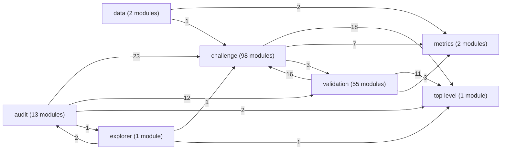

# The code

The project has 172 modules in 7 packages, and the modules hold 588 imports of one another. Each arrow below goes from a package to a package whose modules it imports, and its label counts those imports.

A module-level drawing of the largest packages would hold hundreds of arrows and say less than the tables, so each package below lists its modules with what they import and what imports them.

## challenge (98 modules)

Code for the OpenADMET CYP Inhibition Blind Challenge -- reproducing the official tutorial's baselines first, then extending them with CYPMode's own mechanistic features.

| module | what it does | imports | imported by |
| --- | --- | --- | --- |
| `cypmode/challenge/addition_experiment.py` | Shared pre-registered test for "does adding this candidate group improve the assembled model?". | `challenge.feature_store`, `challenge.label_confidence`, `challenge.leaderboard_prior`, `challenge.model_comparison`, `challenge.nested`, `challenge.nested_runners` and 1 more | `challenge.arms_experiment`, `challenge.aux_experiments`, `challenge.committee_label_model`, `challenge.frozen_embeddings`, `challenge.mmp_transfer`, `challenge.monroe_embeddings` and 6 more |
| `cypmode/challenge/all_in_one.py` | The all-in-one comparison: the final stack against one stack that holds every candidate that was ever cached (declared 2026-10-22, before any result). | `challenge.feature_store`, `challenge.final_tdi_build`, `challenge.label_confidence`, `challenge.leaderboard_prior`, `challenge.model_comparison`, `challenge.nested` and 4 more | none |
| `cypmode/challenge/applicability_domain.py` | Applicability domain of the 750 blinded compounds, generated from the final build. | `challenge.feature_store`, `challenge.final_tdi_build`, `challenge.grouping`, `challenge.leaderboard_prior`, `challenge.nested`, `challenge.submission` and 1 more | none |
| `cypmode/challenge/architecture_significance.py` | Tests whether CYP2D6 does better under an independent-head model (cypmode.challenge.tdi_baseline/threshold_tuning's own approach, same family as CYP3A4's deployed model -- a standalone LightGBM trained on CYP2D6 data alone) or the shared-trunk multitask model (cypmode.challenge.multitask -- trained jointly with CYP3A4's data via a shared representation), on CYP2D6's own m3_no_amine_features. | `challenge.multitask`, `challenge.stacking_significance`, `challenge.tdi_ablation`, `challenge.tdi_baseline`, `challenge.threshold_tuning` | `challenge.cyp2d6_tuning_significance` |
| `cypmode/challenge/arms_experiment.py` | Floor-clipped two-arm regression (job 078). | `challenge.addition_experiment`, `challenge.nested_runners` | none |
| `cypmode/challenge/atomjepa_embeddings.py` | Frozen Atom-JEPA embeddings as a label-free feature block. | `provenance` | `challenge.feature_store`, `challenge.nested_runners_torch` |
| `cypmode/challenge/aux_blocks.py` | Candidates that use the official auxiliary readings (single-concentration screen, Emax) and the two-part form of the TDI label. | `challenge.nested`, `challenge.nested_runners`, `challenge.official_extra`, `challenge.tdi_targets` | `challenge.aux_experiments`, `challenge.final_tdi_build`, `challenge.nested_runners`, `challenge.screen_selection` |
| `cypmode/challenge/aux_experiments.py` | Pre-registered tests of the candidates that use the official auxiliary readings and the two-part form of the label (see `aux_blocks`), and of the candidates whose predictions come from the torch environment (TabICL, the multitask network. | `challenge.addition_experiment`, `challenge.aux_blocks`, `challenge.cached_candidates`, `challenge.nested_runners`, `provenance` | none |
| `cypmode/challenge/basic_centre.py` | Basic-centre block: where the molecule carries its positive charge at physiological pH, and how far that charge sits from the aromatic rings. | none | `challenge.feature_store` |
| `cypmode/challenge/bindingdb_auxiliary.py` | Auxiliary direct-CYP-binding signal from BindingDB (bindingdb.org) -- targeted REST pulls for CYP3A4 (UniProt P08684) and CYP2D6 (UniProt P10635) specifically, not a bulk database download (same narrowly-scoped pattern as cypmode.challenge.pubchem_auxiliary's PubChem AID 1851 integration: BindingDB's own full dumps run 240MB-3GB. | `challenge.structure_standardization`, `challenge.tdi_ablation`, `challenge.tdi_baseline` | `challenge.combined_features`, `challenge.stacking_significance` |
| `cypmode/challenge/block_holdout.py` | Test-like holdout: the ids 2,395,316-2,395,799 block of the training file. | `challenge.library_blocks`, `challenge.nested`, `challenge.nested_runners`, `challenge.validation_matching` | none |
| `cypmode/challenge/cached_candidates.py` | Candidates whose predictions are produced outside the LightGBM environment and only read here (TabICL, the multitask network, Chemprop and CheMeleon). | `challenge.nested_runners` | `challenge.aux_experiments`, `challenge.final_tdi_build` |
| `cypmode/challenge/calibration_experiment.py` | Does a post-hoc calibration step make the stack's probabilities usable? | `challenge.leaderboard_prior`, `challenge.nested`, `challenge.nested_runners`, `challenge.validation_matching` | `audit.sections`, `challenge.committee_label_model`, `challenge.final_tdi_build` |
| `cypmode/challenge/chemberta_features.py` | Transformer-based SMILES embeddings via ChemBERTa (seyonec/ChemBERTa-zinc-base-v1, a real, published RoBERTa model pretrained by masked-language-modeling on 100k ZINC SMILES strings according to its model card, via HuggingFace transformers) -- a third molecular representation alongside M3's existing two (RDKit descriptors, Morgan fingerprint). | `challenge.tdi_baseline` | `challenge.chemberta_significance`, `challenge.multitask` |
| `cypmode/challenge/chemberta_significance.py` | Repeated-CV + Tukey HSD significance test for the ChemBERTa feature (cypmode.challenge.chemberta_features) against M3 -- kept as a fully separate module/process from chemberta_features.py on purpose: this file imports lightgbm, sklearn, and statsmodels, and NEVER imports torch or transformers, so it is always safe to run regardless of process history. | `challenge.chemberta_features`, `challenge.knn_features`, `challenge.stacking_significance`, `challenge.tdi_ablation`, `challenge.tdi_baseline` | none |
| `cypmode/challenge/chembl_auxiliary.py` | Auxiliary direct-CYP-activity signal from ChEMBL (ebi.ac.uk/chembl) -- targeted REST pulls for CYP3A4 (target CHEMBL340) and CYP2D6 (target CHEMBL289) specifically, not a bulk database download (same narrowly- scoped pattern as cypmode.challenge.pubchem_auxiliary's AID 1851 pull and cypmode.challenge.bindingdb_auxiliary's targeted BindingDB pull). | `challenge.structure_standardization`, `challenge.tdi_ablation`, `challenge.tdi_baseline` | `challenge.external_auxiliary_significance` |
| `cypmode/challenge/chemeleon_speed.py` | The speed test and the rule of the decision on the fine-tuned CheMeleon (queue job 202_chemeleon_speed). | `challenge.nested`, `challenge.nested_runners_chemprop` | none |
| `cypmode/challenge/chemeleon_stage.py` | The rule that decides whether the second stage of the CheMeleon design runs. | none | none |
| `cypmode/challenge/combined_features.py` | Combines the three real, independently-validated feature additions -- KNN read-across (cypmode.challenge.knn_features), PubChem AID 1851 auxiliary activity (cypmode.challenge.pubchem_auxiliary), and BindingDB auxiliary activity (cypmode.challenge.bindingdb_auxiliary) -- into one feature set and tests them together. | `challenge.bindingdb_auxiliary`, `challenge.knn_features`, `challenge.pubchem_auxiliary`, `challenge.tdi_ablation`, `challenge.tdi_baseline` | none |
| `cypmode/challenge/committee_label_model.py` | Probabilistic label-process model: a committee of two-arm regressors that outputs P(label) and expected improvement. | `challenge.addition_experiment`, `challenge.calibration_experiment`, `challenge.label_confidence`, `challenge.leaderboard_prior`, `challenge.nested`, `challenge.nested_runners` and 2 more | `challenge.nested_runners` |
| `cypmode/challenge/committee_uncertainty.py` | Query-by-committee uncertainty, judged against real held-out errors -- and against the simplest possible baseline. | `challenge.feature_store`, `challenge.nested`, `challenge.nested_runners`, `challenge.validation_matching` | `audit.sections` |
| `cypmode/challenge/confidence_experiment.py` | Does training on label confidence help when the evaluation matches the scoring rule? | `challenge.feature_store`, `challenge.label_confidence`, `challenge.leaderboard_prior`, `challenge.model_comparison`, `challenge.nested`, `challenge.nested_runners` and 1 more | none |
| `cypmode/challenge/cyp2d6_tuning_significance.py` | Tests three untried levers for CYP2D6's deployed shared-trunk model -- hyperparameter tuning, class-weighted loss, and seed ensembling -- after 8 independent feature additions (KNN, Tier3 structural, ChemBERTa, quantum pharmacophore, pharmacophore fingerprint, BindingDB, AID1851, ChEMBL) all came back null against repeated CV + Tukey HSD. | `challenge.architecture_significance`, `challenge.multitask`, `challenge.stacking_significance` | none |
| `cypmode/challenge/external_activity.py` | Predicted inhibition of the five major CYP isoforms by models trained ONLY on external data. | `challenge.feature_store` | `challenge.external_continuous`, `challenge.feature_store` |
| `cypmode/challenge/external_auxiliary_significance.py` | Repeated-CV + Tukey HSD significance test for the two external auxiliary-activity sources that showed a real, consistent single-split bump for CYP2D6 -- cypmode.challenge.pubchem_auxiliary's AID 1851 panel (CYP2D6 single-split MCC 0.072->0.104) and cypmode.challenge. chembl_auxiliary's ChEMBL pull (0.072->0.104. | `challenge.chembl_auxiliary`, `challenge.pubchem_auxiliary`, `challenge.stacking_significance`, `challenge.tdi_ablation`, `challenge.tdi_baseline` | none |
| `cypmode/challenge/external_continuous.py` | Continuous readings of the NCATS qHTS cytochrome panel (PubChem AID 1851) as a label-free feature block. | `challenge.external_activity`, `challenge.feature_store`, `provenance` | `challenge.feature_store`, `challenge.openadmet_surrogates` |
| `cypmode/challenge/feature_store.py` | Every fingerprint/descriptor block, computed once for all compounds (training and blinded test) and cached, so any candidate model can assemble its inputs by block name instead of re-deriving features per experiment. | `challenge.atomjepa_embeddings`, `challenge.basic_centre`, `challenge.external_activity`, `challenge.external_continuous`, `challenge.frozen_embeddings`, `challenge.monroe_embeddings` and 7 more | `audit.sections`, `audit.sections_extra`, `challenge.addition_experiment`, `challenge.all_in_one`, `challenge.applicability_domain`, `challenge.committee_uncertainty` and 18 more |
| `cypmode/challenge/final_assembly.py` | The final assembled TDI model: combines the settled, evidence-based per-isoform architecture choice into one pipeline that produces real predictions on the real 750-row blinded test set and writes a validated submission file. | `challenge.knn_features`, `challenge.submission`, `challenge.tdi_ablation`, `challenge.tdi_baseline`, `challenge.threshold_tuning` | none |
| `cypmode/challenge/final_assembly_cyp2d6.py` | CYP2D6's deployed model: the shared trunk, m3_no_amine_features only. | `challenge.multitask`, `challenge.submission`, `challenge.tdi_ablation`, `challenge.tdi_baseline` | none |
| `cypmode/challenge/final_tdi_build.py` | Gate-driven final TDI build: from the experiment verdicts to validated candidate submission files. | `challenge.aux_blocks`, `challenge.cached_candidates`, `challenge.calibration_experiment`, `challenge.feature_store`, `challenge.label_confidence`, `challenge.leaderboard_prior` and 7 more | `audit.method_report`, `challenge.all_in_one`, `challenge.applicability_domain`, `challenge.why_no_gain` |
| `cypmode/challenge/foundation_weights.py` | Make the OpenADMET Chemprop pretraining weights loadable by `chemprop train --from-foundation`. | none | none |
| `cypmode/challenge/frozen_embeddings.py` | Frozen CheMeleon foundation embeddings as a feature block (job 050). | `challenge.addition_experiment`, `challenge.nested_runners`, `provenance` | `challenge.feature_store`, `challenge.nested_runners_torch` |
| `cypmode/challenge/functional_groups.py` | The functional groups of the pharmacophore atlas (declared on 2026-10-23 before any code of it ran). | `metrics.motifs` | none |
| `cypmode/challenge/grouping.py` | Group labels for group-aware validation: cluster compounds so that whole chemical series stay on one side of every split. | `challenge.validation_matching` | `challenge.applicability_domain`, `challenge.nested_runners` |
| `cypmode/challenge/hedged_blend.py` | Hedged CYP2D6 model: a rank blend of the hits-only stack and the selection-aware stack, judged across regimes. | `challenge.feature_store`, `challenge.label_confidence`, `challenge.leaderboard_prior`, `challenge.model_comparison`, `challenge.nested`, `challenge.nested_runners` and 2 more | `challenge.population_physics`, `challenge.screen_selection`, `challenge.selection_decision` |
| `cypmode/challenge/knn_features.py` | KNN-label (read-across) features: for each compound, the known TDI status of its K nearest chemical neighbors (by Tanimoto similarity on ECFP4), aggregated into a small feature set. | `challenge.tdi_ablation`, `challenge.tdi_baseline` | `challenge.chemberta_significance`, `challenge.combined_features`, `challenge.final_assembly`, `challenge.pharmacophore_fingerprint`, `challenge.qm_reactivity_significance`, `challenge.quantum_pharmacophore_significance` and 2 more |
| `cypmode/challenge/label_confidence.py` | How confidently is a compound's TDI label assigned? -- the scored set only contains confident labels. | `challenge.tdi_targets` | `audit.core`, `audit.sections`, `challenge.addition_experiment`, `challenge.all_in_one`, `challenge.committee_label_model`, `challenge.confidence_experiment` and 12 more |
| `cypmode/challenge/label_shift.py` | An estimate of the positive rate of the scored test set that does not read a public leaderboard. | `challenge.nested`, `challenge.nested_runners`, `challenge.validation_matching` | none |
| `cypmode/challenge/leaderboard_prior.py` | Positive rate of the blinded test set, recovered from the public leaderboard. | none | `audit.core`, `challenge.addition_experiment`, `challenge.all_in_one`, `challenge.applicability_domain`, `challenge.calibration_experiment`, `challenge.committee_label_model` and 13 more |
| `cypmode/challenge/library_blocks.py` | The training set is not one library: find the block whose compounds went through the all-isoform panel. | none | `challenge.block_holdout`, `challenge.nested_runners` |
| `cypmode/challenge/mmp_transfer.py` | SAR made explicit: matched-molecular-pair transformations (job 047). | `challenge.addition_experiment`, `challenge.nested_runners` | `challenge.nested_runners` |
| `cypmode/challenge/model_comparison.py` | Inference for "is pipeline A better than pipeline B" -- done on retrained models, not on frozen predictions. | `challenge.nested` | `challenge.addition_experiment`, `challenge.all_in_one`, `challenge.confidence_experiment`, `challenge.final_tdi_build`, `challenge.hedged_blend`, `challenge.nonneg_stack` and 7 more |
| `cypmode/challenge/monroe_embeddings.py` | Frozen Monroe embeddings as a feature block and as the input of TabICL (job 209). | `challenge.addition_experiment`, `challenge.nested_runners`, `provenance` | `challenge.feature_store`, `challenge.nested_runners_torch` |
| `cypmode/challenge/multiplicity.py` | Multiplicity of the additions tested together: Holm-adjusted p-values next to the pre-registered gates. | none | `audit.method_report`, `audit.sections_extra` |
| `cypmode/challenge/multitask.py` | A small, plain-PyTorch shared-trunk multitask model -- tests the "shared representation helps" hypothesis from CYPMode_Architecture_Specification.md's Decision Log ("Shared trunk. | `challenge.chemberta_features`, `challenge.tdi_ablation`, `challenge.tdi_baseline` | `challenge.architecture_significance`, `challenge.cyp2d6_tuning_significance`, `challenge.final_assembly_cyp2d6` |
| `cypmode/challenge/nested.py` | Selection-corrected evaluation: judge the whole *procedure* that picks a model, not the winner of a contest scored on the same folds that crowned it. | `challenge.validation_matching`, `provenance` | `audit.core`, `audit.method_report`, `audit.sections`, `challenge.addition_experiment`, `challenge.all_in_one`, `challenge.applicability_domain` and 26 more |
| `cypmode/challenge/nested_deploy.py` | Turn the nested-CV prediction caches into a TDI submission candidate. python -m cypmode.challenge.nested_deploy --out data/tdi_track/outputs/nested/submission_candidate.csv For each isoform it runs the PRE-REGISTERED selection procedure (an L1/L2-penalised logistic stack of every complete candidate. | `challenge.feature_store`, `challenge.leaderboard_prior`, `challenge.nested`, `challenge.nested_runners`, `challenge.submission`, `challenge.validation_matching` | none |
| `cypmode/challenge/nested_report.py` | Comparison of every cached candidate and every selection procedure for one isoform. python -m cypmode.challenge.nested_report --isoform CYP3A4 --board <per-isoform leaderboard csv> Prints, per candidate, its own outer-fold score (no selection involved), then per selector the inner (contest) score, the outer score of its frozen choice and the optimism between them. | `challenge.feature_store`, `challenge.leaderboard_prior`, `challenge.nested`, `challenge.nested_runners`, `challenge.validation_matching` | none |
| `cypmode/challenge/nested_runners.py` | Turn candidate model specifications into cached predictions for a NestedPlan. | `challenge.aux_blocks`, `challenge.committee_label_model`, `challenge.feature_store`, `challenge.grouping`, `challenge.label_confidence`, `challenge.library_blocks` and 9 more | `audit.core`, `audit.docs_state`, `audit.method_report`, `audit.sections`, `challenge.addition_experiment`, `challenge.all_in_one` and 31 more |
| `cypmode/challenge/nested_runners_chemprop.py` | Chemprop (directed message-passing GNN) candidates for a NestedPlan, run through the Chemprop command line in the isolated torch environment (.venv-ml). | `challenge.nested`, `challenge.tdi_targets`, `provenance` | `challenge.chemeleon_speed` |
| `cypmode/challenge/nested_runners_torch.py` | Torch-side candidates (TabICL, multitask MLP over all potency columns) for a NestedPlan. | `challenge.atomjepa_embeddings`, `challenge.feature_store`, `challenge.frozen_embeddings`, `challenge.monroe_embeddings`, `challenge.nested`, `challenge.official_extra` and 2 more | none |
| `cypmode/challenge/nonneg_stack.py` | A non-negative stacking selector, and the pre-registered test of whether it should replace the logistic blend. | `challenge.feature_store`, `challenge.label_confidence`, `challenge.leaderboard_prior`, `challenge.model_comparison`, `challenge.nested`, `challenge.nested_runners` and 1 more | none |
| `cypmode/challenge/official_extra.py` | The official files of the challenge dataset that the first release of this project did not read, audited before anything uses them. | `challenge.tdi_targets` | `challenge.aux_blocks`, `challenge.nested_runners`, `challenge.nested_runners_torch`, `data.octant_benchmark` |
| `cypmode/challenge/oof_bridge.py` | Out-of-fold direct-inhibition pIC50 bridge for the TDI model. | none | none |
| `cypmode/challenge/openadmet_surrogates.py` | Properties predicted by OpenADMET's surrogate models (logD and mouse brain protein binding) as label-free feature columns. | `challenge.external_continuous`, `provenance` | `challenge.feature_store` |
| `cypmode/challenge/pair_transfer.py` | SAR-aware pair-conditional label transfer (job 046). | `challenge.addition_experiment`, `challenge.nested_runners` | `challenge.nested_runners` |
| `cypmode/challenge/permutation_control.py` | Label-permutation control of the whole nested pipeline (a randomisation test: Leach, Molecular Modelling, 2nd ed., section 12.13.1). | `challenge.feature_store`, `challenge.label_confidence`, `challenge.leaderboard_prior`, `challenge.nested`, `challenge.nested_runners`, `challenge.validation_matching` | none |
| `cypmode/challenge/pharmacophore_fingerprint.py` | 3-point pharmacophore fingerprints via pmapper (github.com/DrrDom/pmapper) -- real, actively maintained, and lightweight (only rdkit + networkx, no heavy compiled backend, unlike tblite -- confirmed directly no OpenMP-conflict risk with LightGBM the way quantum_pharmacophore.py's tblite dependency has). | `challenge.knn_features`, `challenge.stacking_significance`, `challenge.tdi_ablation`, `challenge.tdi_baseline` | none |
| `cypmode/challenge/pharmacophore_hypotheses.py` | Ligand-based pharmacophore hypothesis model (declared on 2026-10-23 before this code ran). | `challenge.label_confidence`, `challenge.pocket_pharmacophore`, `challenge.tdi_targets`, `provenance` | `challenge.nested_runners` |
| `cypmode/challenge/physics_block.py` | Atom-, site- and pharmacophore-aware GFN2-xTB physics block (job 070). | `provenance` | `audit.sections_extra`, `challenge.feature_store`, `challenge.physics_tierb`, `validation.pose_awareness` |
| `cypmode/challenge/physics_compact_experiment.py` | Compact physics: only the physics columns that matter, chosen inside every task (job 072). | `challenge.addition_experiment`, `challenge.nested_runners` | none |
| `cypmode/challenge/physics_experiment.py` | Does the atom-, site- and pharmacophore-aware GFN2-xTB block improve the TDI model? | `challenge.addition_experiment`, `challenge.nested_runners` | none |
| `cypmode/challenge/physics_tierb.py` | Physics block, tier B: Boltzmann-weighted conformers and relaxed hydrogen-abstraction energies for the two best sites. | `challenge.physics_block`, `provenance` | `challenge.feature_store` |
| `cypmode/challenge/physics_tierb_experiment.py` | Physics tier B: Boltzmann-weighted conformers and relaxed hydrogen abstraction (job 074). | `challenge.addition_experiment`, `challenge.nested_runners` | none |
| `cypmode/challenge/pocket_pharmacophore.py` | Pocket-level pharmacophore block (declared on 2026-10-23 before any result). | `provenance`, `validation.build_input` | `challenge.feature_store`, `challenge.pharmacophore_hypotheses`, `validation.conformer_bias`, `validation.ligand_dynamics`, `validation.official_pharmacophore`, `validation.pose_pharmacophore` and 1 more |
| `cypmode/challenge/population_experiment.py` | Selection-aware TDI modelling: is the model for the SCORED population better than the model for the hits? | `challenge.feature_store`, `challenge.label_confidence`, `challenge.leaderboard_prior`, `challenge.model_comparison`, `challenge.nested`, `challenge.nested_runners` and 2 more | `challenge.final_tdi_build`, `challenge.hedged_blend`, `challenge.population_physics`, `challenge.screen_selection`, `challenge.selection_aware_v2` |
| `cypmode/challenge/population_physics.py` | Physics inside the selection-aware CYP2D6 model (job 071). | `challenge.feature_store`, `challenge.hedged_blend`, `challenge.label_confidence`, `challenge.leaderboard_prior`, `challenge.model_comparison`, `challenge.nested` and 3 more | none |
| `cypmode/challenge/population_share.py` | How many never-measured compounds does the scored CYP2D6 test set contain? | `challenge.feature_store`, `challenge.tdi_baseline`, `challenge.validation_matching` | none |
| `cypmode/challenge/pubchem_auxiliary.py` | Auxiliary direct-CYP-activity signal from PubChem AID 1851 ("Cytochrome panel assay with activity outcomes", NCATS) -- a real, verified qHTS assay of 17,143 diverse NCATS screening-library compounds against five CYP isozymes (1A2, 2C9, 2C19, 2D6, 3A4), single-incubation inhibitor/substrate activity calls (no preincubation comparison, so it has no TDI labels of its own -- see module docstring's Note on scope below). | `challenge.structure_standardization`, `challenge.tdi_ablation`, `challenge.tdi_baseline` | `challenge.combined_features`, `challenge.external_auxiliary_significance` |
| `cypmode/challenge/qm_reactivity_features.py` | Continuous QM-surrogate reactivity features via qmdesc (a real, published graph neural network -- Guan et al., "Regio-Selectivity Prediction with a Machine-Learned Reaction Representation and On-the-Fly Quantum Mechanical Descriptors" -- github.com/yanfeiguan/qmdesc), predicting real B3LYP/def2svp-level QM descriptors (Hirshfeld partial charge, nucleophilic/electrophilic Fukui indices, NMR shielding. | `challenge.submission`, `challenge.tdi_baseline`, `metrics.amines` | `challenge.qm_reactivity_significance` |
| `cypmode/challenge/qm_reactivity_significance.py` | Repeated-CV + Tukey HSD significance test for the QM-reactivity feature (cypmode.challenge.qm_reactivity_features) against M3 -- kept as a fully separate module/process on purpose, same reasoning as chemberta_significance.py: this file imports lightgbm, sklearn, and statsmodels, and never imports torch or qmdesc. | `challenge.knn_features`, `challenge.qm_reactivity_features`, `challenge.stacking_significance`, `challenge.tdi_ablation`, `challenge.tdi_baseline` | none |
| `cypmode/challenge/quantum_pharmacophore.py` | Quantum-derived pharmacophore features via tblite's own Python bindings to GFN2-xTB, a real, published semi-empirical quantum method -- NOT xtb-python (confirmed unmaintained) and NOT full DFT (confirmed infeasible: minutes-to-hours per molecule on this hardware). | `challenge.tdi_ablation`, `challenge.tdi_baseline` | `challenge.quantum_pharmacophore_significance` |
| `cypmode/challenge/quantum_pharmacophore_significance.py` | Ablation + repeated-CV/Tukey HSD significance test for the quantum- electronic feature (cypmode.challenge.quantum_pharmacophore) against M3 -- kept as a fully separate module/process from quantum_pharmacophore.py on purpose: this file imports lightgbm, sklearn, and statsmodels, and NEVER imports tblite, so it is always safe to run regardless of process history. | `challenge.knn_features`, `challenge.quantum_pharmacophore`, `challenge.stacking_significance`, `challenge.tdi_ablation`, `challenge.tdi_baseline` | none |
| `cypmode/challenge/recompute_paired_summaries.py` | Re-analyse the saved per-fold tables of the older significance experiments with the paired corrected t (Holm). | `challenge.stacking_significance` | none |
| `cypmode/challenge/reliability.py` | Cross-cutting reliability score: ensemble disagreement + chemical OOD distance (+ Boltz-2 structural confidence, wired in once Tier 3 results exist) and, from the nested harness, the query-by-committee signals and the decision margin. | `challenge.tdi_baseline` | `challenge.split_validity` |
| `cypmode/challenge/replicate_verdict.py` | Verdict of the 10-outer-fold replicate for the physics additions and for the neural pair (the multitask network with plain Chemprop). | none | none |
| `cypmode/challenge/screen_selection.py` | The real single-concentration screen inside the selection-aware CYP2D6 model (job 196). | `challenge.aux_blocks`, `challenge.feature_store`, `challenge.hedged_blend`, `challenge.label_confidence`, `challenge.leaderboard_prior`, `challenge.model_comparison` and 4 more | none |
| `cypmode/challenge/selection_aware_v2.py` | Selection-aware v2: a gate that sees the screen's whole promotion pattern (job 040). v1 (population_experiment.py) multiplies P(label \| hit) by a gate P(hit) learned from structure alone. | `challenge.feature_store`, `challenge.label_confidence`, `challenge.leaderboard_prior`, `challenge.model_comparison`, `challenge.nested`, `challenge.nested_runners` and 2 more | none |
| `cypmode/challenge/selection_decision.py` | Which CYP2D6 file is the final entry: the hits-only file A or the selection-aware file B? | `challenge.hedged_blend` | none |
| `cypmode/challenge/softmax_selector.py` | A softmax-temperature selector between exploiting the best model and exploring a committee, and the pre-registered test of whether it should replace the logistic blend. | `challenge.feature_store`, `challenge.label_confidence`, `challenge.leaderboard_prior`, `challenge.model_comparison`, `challenge.nested`, `challenge.nested_runners` and 1 more | none |
| `cypmode/challenge/split_validity.py` | Checks whether a train/test split is actually informative before trusting any MCC computed on it -- a validation set that is chemically close to training (near-duplicates/analogs) can make a CV split look far more reliable than performance on novel chemistry actually is, a known general risk in cheminformatics benchmarking. | `challenge.reliability`, `challenge.tdi_baseline` | none |
| `cypmode/challenge/stacking_significance.py` | Statistical significance testing for feature-stacking comparisons -- repeated CV with the corrected resampled t of Nadeau and Bengio (Holm-adjusted over the pairs), not a single point-estimate MCC delta and not an unpaired test on correlated folds. | `challenge.bindingdb_auxiliary`, `challenge.knn_features`, `challenge.model_comparison`, `challenge.tdi_ablation`, `challenge.tdi_baseline` | `challenge.architecture_significance`, `challenge.chemberta_significance`, `challenge.cyp2d6_tuning_significance`, `challenge.external_auxiliary_significance`, `challenge.pharmacophore_fingerprint`, `challenge.qm_reactivity_significance` and 4 more |
| `cypmode/challenge/structure_standardization.py` | Structure standardization for cross-dataset compound matching, via ChEMBL's own structure pipeline (chembl_structure_pipeline, pip-installable, rdkit-only dependency -- the same tool ChEMBL uses internally to curate its own structures). | none | `challenge.bindingdb_auxiliary`, `challenge.chembl_auxiliary`, `challenge.pubchem_auxiliary` |
| `cypmode/challenge/structure_submission.py` | Builds the real Structure Track submission zip. | `validation.pose_validity`, `validation.structures` | `validation.final_recipe`, `validation.ligand_dynamics`, `validation.official_posebusters`, `validation.ost_official`, `validation.ost_pools`, `validation.pose_stereo` and 2 more |
| `cypmode/challenge/submission.py` | TDI submission formatting and validation against the official schema. | none | `audit.pre_submission`, `audit.sections_extra`, `challenge.all_in_one`, `challenge.applicability_domain`, `challenge.final_assembly`, `challenge.final_assembly_cyp2d6` and 7 more |
| `cypmode/challenge/submissions_sync.py` | Brings `submissions/` to the state of the final results: the files that would be uploaded to the challenge portal, each checked with the portal's own rules, with checksums and a README per track. | `challenge.submission` | none |
| `cypmode/challenge/tdi_ablation.py` | M0-M3 ablation: does CYPMode's Tier 2 evidence (motif + trialkylamine flags) actually help a real multivariate TDI classifier, beyond the plain RDKit-descriptor baseline? | `challenge.tdi_baseline`, `metrics.amines`, `metrics.motifs` | `challenge.architecture_significance`, `challenge.bindingdb_auxiliary`, `challenge.chemberta_significance`, `challenge.chembl_auxiliary`, `challenge.combined_features`, `challenge.external_auxiliary_significance` and 13 more |
| `cypmode/challenge/tdi_baseline.py` | Reproduces the OpenADMET CYP Blind Challenge tutorial's own TDI baseline: one LightGBM classifier per isoform (CYP3A4, CYP2D6) on RDKit descriptors, evaluated over repeated stratified splits. | none | `audit.sections`, `challenge.architecture_significance`, `challenge.bindingdb_auxiliary`, `challenge.chemberta_features`, `challenge.chemberta_significance`, `challenge.chembl_auxiliary` and 20 more |
| `cypmode/challenge/tdi_targets.py` | The TDI label is a deterministic function of two measured pIC50 values, and the training file carries both of them -- this module makes that explicit so models can learn the continuous quantity instead of its thresholded shadow. | none | `audit.sections`, `challenge.aux_blocks`, `challenge.committee_label_model`, `challenge.label_confidence`, `challenge.nested_runners`, `challenge.nested_runners_chemprop` and 4 more |
| `cypmode/challenge/test_likeness_training.py` | Test-likeness-weighted training (job 060). | `challenge.addition_experiment`, `challenge.nested_runners` | none |
| `cypmode/challenge/test_nonhit_share.py` | How hit-like is the blinded test set? | `challenge.nested_runners` | none |
| `cypmode/challenge/threshold_tuning.py` | CV-fold-internal, MCC-optimized decision thresholds -- per isoform, not a single threshold shared across CYP3A4 and CYP2D6, and never touching a validation/test fold's own labels to pick the threshold used on it. | `challenge.tdi_ablation`, `challenge.tdi_baseline` | `challenge.architecture_significance`, `challenge.final_assembly` |
| `cypmode/challenge/tier3_features.py` | Joins a Tier 3 (real Boltz-2 structural evidence) batch into the TDI feature matrix, and tests whether it moves that isoform's classification performance. | `challenge.stacking_significance`, `challenge.tdi_ablation`, `challenge.tdi_baseline` | `challenge.tier3_knn_significance` |
| `cypmode/challenge/tier3_knn_significance.py` | Tests whether Tier 3 structural features and KNN read-across, combined, move classification performance -- specifically for CYP2D6, where each was already validated SEPARATELY and each came back null-to-negative on its own (see cypmode.challenge.tier3_features and cypmode.challenge.knn_features's own CYP2D6 results). | `challenge.knn_features`, `challenge.stacking_significance`, `challenge.tdi_ablation`, `challenge.tdi_baseline`, `challenge.tier3_features` | none |
| `cypmode/challenge/tier3_selection.py` | Fold-local Tier 3 selection mask: decides which TDI compounds are worth the expense of a real Boltz-2 structural run, without ever letting a validation fold's own labels influence that decision. | `metrics.motifs` | none |
| `cypmode/challenge/validation_matching.py` | Make cross-validation resemble the blinded test set. | none | `audit.core`, `challenge.addition_experiment`, `challenge.all_in_one`, `challenge.applicability_domain`, `challenge.block_holdout`, `challenge.calibration_experiment` and 20 more |
| `cypmode/challenge/why_no_gain.py` | Why an idea that did not join the final stack added nothing: diagnostics generated from the cached predictions. | `challenge.feature_store`, `challenge.final_tdi_build`, `challenge.label_confidence`, `challenge.leaderboard_prior`, `challenge.model_comparison`, `challenge.nested` and 2 more | none |
| `cypmode/challenge/xiso_transfer.py` | Cross-isoform transfer of the assay arms (job 076). | `challenge.addition_experiment`, `challenge.nested`, `challenge.nested_runners`, `challenge.tdi_targets` | `challenge.nested_runners` |

## validation (55 modules)

Structural validation against Boltz-2 predictions.

| module | what it does | imports | imported by |
| --- | --- | --- | --- |
| `cypmode/validation/affinity_retry.py` | Complete the base-run table of the official ligands when the affinity step of a run was skipped for memory (registered on 2026-10-25). | `provenance`, `validation.batch`, `validation.structures` | `audit.sections_extra` |
| `cypmode/validation/batch.py` | Batch orchestration: run structural validation across many compounds, one call. cypmode.validation.pipeline.run_structural_validation handles one compound end to end, but a real batch (e.g. every compound in an external blinded test set) needs that call repeated across many compounds, with two things a plain loop does not give for free. | `provenance`, `validation.conformers`, `validation.pipeline` | `validation.affinity_retry` |
| `cypmode/validation/bioemu2.py` | Resumable BioEmu2 runner -- a candidate third structure engine next to Boltz-2 and OpenFold3, never a replacement. | `provenance` | `validation.pose_pools` |
| `cypmode/validation/bisy_rmsd.py` | A local approximation of BiSyRMSD, the Structure Track's own secondary metric (see CYPMode_Architecture_Specification.md's "Official challenge update" section) -- for internal self-consistency checks, NOT exact leaderboard parity. | `validation.structures` | none |
| `cypmode/validation/boltz_cpu_fp32.py` | Run `boltz predict` in float32 when it runs on the CPU. | none | none |
| `cypmode/validation/build_input.py` | Builds Boltz-2 YAML inputs (protein + heme, covalently bonded) for any ligand. | `metrics.motifs` | `challenge.pocket_pharmacophore`, `validation.final_recipe`, `validation.pipeline`, `validation.pose_awareness`, `validation.restraint_expansion` |
| `cypmode/validation/build_summary.py` | Regenerates data/structure_track/outputs/{target}/validation_summary.json (cyp3a4 by default) from local Boltz-2 runs. | `validation.structures` | none |
| `cypmode/validation/conformer_benchmark.py` | Batch input for the conformer-conditioning experiment on the crystal benchmark. | `validation.conformers`, `validation.pose_rescoring_validation`, `validation.reference_ligands` | none |
| `cypmode/validation/conformer_bias.py` | Check of the conformational bias of the ligand ensembles (declared on 2026-10-23 before any code ran). | `challenge.pocket_pharmacophore`, `provenance` | none |
| `cypmode/validation/conformers.py` | Distinct crystal conformations of the CYP3A4 pocket, to condition co-folding on more than one of them. | `validation.pose_rescoring`, `validation.reference_ligands` | `validation.batch`, `validation.conformer_benchmark`, `validation.cryoem_templates`, `validation.diversity_pilot` |
| `cypmode/validation/constants.py` | Shared constants with no heavy dependencies of their own. | none | `validation.pipeline`, `validation.pose_consensus`, `validation.structures` |
| `cypmode/validation/cryoem_templates.py` | Cryo-EM protein templates for the pose pool (job 135). | `validation.conformers`, `validation.pose_rescoring_validation`, `validation.reference_ligands` | `validation.final_recipe` |
| `cypmode/validation/diversity_pilot.py` | Pilot: which lever makes Boltz-2's pose pool differ, and does the difference reach the right pose? | `validation.conformers`, `validation.pose_consensus`, `validation.pose_rescoring_validation`, `validation.reference_ligands`, `validation.structures` | `validation.final_recipe`, `validation.structure_gates` |
| `cypmode/validation/ei_sampling.py` | Expected-improvement sampling: spend extra poses where the pool disagrees most (job 172). | `validation.pose_pools`, `validation.selection_validation` | `validation.ost_pool_gates` |
| `cypmode/validation/final_recipe.py` | Gate-driven final structure recipe: decide from the verdicts, run on the 20 official ligands, select, validate, zip. | `challenge.structure_submission`, `challenge.submission`, `provenance`, `validation.build_input`, `validation.cryoem_templates`, `validation.diversity_pilot` and 10 more | `validation.pose_margins`, `validation.stereo_rerun` |
| `cypmode/validation/heme_frame_prior.py` | Heme-frame pose prior from crystal ligands (job 175). | `validation.pose_pools`, `validation.reference_ligands`, `validation.selection_validation`, `validation.structures` | `validation.final_recipe`, `validation.ost_pool_gates` |
| `cypmode/validation/lddt_to_crystal.py` | LDDT-PLI of a predicted pose against the experimental pose of the same ligand, the metric the Structure Track is scored by. | `validation.pose_pools`, `validation.pose_rescoring`, `validation.pose_rescoring_validation`, `validation.pose_selection`, `validation.reference_ligands`, `validation.structures` | `validation.mbr_lddt_reevaluation` |
| `cypmode/validation/ligand_dynamics.py` | Ligand dynamics in the frozen pocket (the rule is in `docs/structure_track/structure_ligand_dynamics.md`, committed before any number of the experiment). | `challenge.pocket_pharmacophore`, `challenge.structure_submission`, `validation.pose_awareness`, `validation.pose_pharmacophore`, `validation.relax`, `validation.structures` | `audit.method_report`, `audit.sections` |
| `cypmode/validation/mbr_lddt_reevaluation.py` | Minimum-Bayes-risk pose selection and the iron-nitrogen restraint, re-scored with LDDT-PLI against the crystal (exploratory). | `validation.lddt_to_crystal`, `validation.pose_pools`, `validation.selection_validation`, `validation.structures` | `validation.ost_pool_gates`, `validation.restraint_expansion` |
| `cypmode/validation/official_pharmacophore.py` | The expected pharmacophore of the 20 official ligands (declared on 2026-10-23 before any code ran). | `challenge.pocket_pharmacophore`, `provenance`, `validation.pose_awareness`, `validation.pose_pharmacophore`, `validation.pose_rescoring`, `validation.site_representation` and 1 more | none |
| `cypmode/validation/official_posebusters.py` | PoseBusters exactly as the challenge's structure scorer applies it, with the numeric margin of every check. | `challenge.structure_submission` | `audit.method_report`, `audit.pre_submission`, `audit.sections_extra`, `validation.final_recipe`, `validation.pose_margins`, `validation.pose_stereo` and 3 more |
| `cypmode/validation/openfold3.py` | Resumable OpenFold3 batch runner -- an ADDED second structure engine next to Boltz-2 (cypmode.validation.pipeline), never a replacement. | none | `validation.ost_pools`, `validation.pose_consensus`, `validation.pose_pools`, `validation.pose_rescoring_validation` |
| `cypmode/validation/ost_official.py` | Does the LDDT-PLI of the project agree with the one the challenge computes with OpenStructure? | `challenge.structure_submission`, `validation.pose_pools`, `validation.pose_rescoring`, `validation.pose_rescoring_validation`, `validation.reference_ligands`, `validation.restraint_expansion` and 1 more | `validation.ost_pools`, `validation.relax_gate` |
| `cypmode/validation/ost_pool_gates.py` | The gates of the pools repeated with OpenStructure's yardstick (the registered consequence of the verdict of `ost_official`). | `validation.ei_sampling`, `validation.heme_frame_prior`, `validation.mbr_lddt_reevaluation`, `validation.ost_pools`, `validation.pose_awareness`, `validation.selection_validation` and 2 more | none |
| `cypmode/validation/ost_pools.py` | OpenStructure's LDDT-PLI and BiSyRMSD for every pose that a pool gate was judged on. | `challenge.structure_submission`, `validation.openfold3`, `validation.ost_official`, `validation.pose_pools` | `validation.ost_pool_gates` |
| `cypmode/validation/ost_regate.py` | The confirmatory restraint gates of `restraint_expansion` repeated with OpenStructure's LDDT-PLI. | `validation.restraint_expansion` | none |
| `cypmode/validation/ost_worker.py` | One OpenStructure scoring of a predicted complex against a reference complex, run inside the `ost` conda environment. | none | none |
| `cypmode/validation/pipeline.py` | End-to-end structural validation: SMILES in, coordination result out. | `validation.build_input`, `validation.constants`, `validation.structures` | `validation.batch` |
| `cypmode/validation/pocket_geometry.py` | Pocket-geometry features from an already-predicted Boltz-2 structure -- a different signal from the Fe-N coordination distance (cypmode.validation.structures): how much of the ligand is buried inside the protein, and how big the cavity around it actually is. | `validation.structures` | `validation.pose_awareness` |
| `cypmode/validation/pose_awareness.py` | Physics-, molecule- and pharmacophore-aware terms for choosing among predicted poses (jobs 168 / 169). | `challenge.physics_block`, `validation.build_input`, `validation.pocket_geometry`, `validation.pose_pools`, `validation.selection_validation`, `validation.structures` | `audit.sections`, `validation.final_recipe`, `validation.ligand_dynamics`, `validation.official_pharmacophore`, `validation.ost_pool_gates`, `validation.pose_pharmacophore` |
| `cypmode/validation/pose_comparison.py` | Symmetry-corrected ligand-pose RMSD between two structure predictions of the same compound -- e.g. two independent Boltz-2 runs (different seeds) for a consistency check, or a prediction against a real deposited reference structure once one is available locally. | `validation.structures` | none |
| `cypmode/validation/pose_consensus.py` | Cross-engine pose consensus: Boltz-2 (the incumbent) vs OpenFold3 (the added second engine, cypmode.validation.openfold3) for the Structure Track. | `validation.constants`, `validation.openfold3`, `validation.pose_rescoring`, `validation.pose_validity`, `validation.reference_ligands`, `validation.structures` | `validation.diversity_pilot`, `validation.final_recipe`, `validation.pose_pools`, `validation.restraint_expansion`, `validation.stereo_rerun`, `validation.structure_gates` |
| `cypmode/validation/pose_margins.py` | Margin audit of every pose in the pools of the official ligands, under the challenge scorer's own PoseBusters call. | `validation.final_recipe`, `validation.official_posebusters`, `validation.pose_pools`, `validation.pose_stereo` | `validation.final_recipe`, `validation.pose_stereo`, `validation.stereo_rerun` |
| `cypmode/validation/pose_pharmacophore.py` | Pharmacophore model of a predicted pose (declared on 2026-10-23 before any code ran). | `challenge.pocket_pharmacophore`, `provenance`, `validation.pose_awareness`, `validation.pose_pools`, `validation.pose_rescoring`, `validation.structures` | `validation.ligand_dynamics`, `validation.official_pharmacophore`, `validation.site_representation` |
| `cypmode/validation/pose_pools.py` | Pose pools of one ligand and the pairwise LDDT-PLI matrix inside them (shared by the structure-track gates). | `validation.bioemu2`, `validation.openfold3`, `validation.pose_consensus`, `validation.pose_selection`, `validation.structures` | `validation.ei_sampling`, `validation.final_recipe`, `validation.heme_frame_prior`, `validation.lddt_to_crystal`, `validation.mbr_lddt_reevaluation`, `validation.ost_official` and 9 more |
| `cypmode/validation/pose_rescoring.py` | Experimental-prior rescoring of a predicted inhibitor pose in CYP3A4. | `validation.structures` | `validation.conformers`, `validation.lddt_to_crystal`, `validation.official_pharmacophore`, `validation.ost_official`, `validation.pose_consensus`, `validation.pose_pharmacophore` and 4 more |
| `cypmode/validation/pose_rescoring_validation.py` | Does cypmode.validation.pose_rescoring actually discriminate a near-native pose from a wrong one? | `validation.openfold3`, `validation.pose_pools`, `validation.pose_rescoring`, `validation.reference_ligands`, `validation.structures` | `validation.conformer_benchmark`, `validation.cryoem_templates`, `validation.diversity_pilot`, `validation.lddt_to_crystal`, `validation.ost_official` |
| `cypmode/validation/pose_selection.py` | Choose one pose from a pool by the metric the challenge scores, instead of the model's own confidence. | `validation.structures` | `validation.lddt_to_crystal`, `validation.pose_pools` |
| `cypmode/validation/pose_stereo.py` | Whether a predicted pose carries the stereochemistry of the official SMILES (registered on 2026-10-24). | `challenge.structure_submission`, `validation.official_posebusters`, `validation.pose_margins` | `audit.pre_submission`, `audit.sections_extra`, `validation.pose_margins`, `validation.relax_final` |
| `cypmode/validation/pose_validity.py` | PoseBusters physical/chemical validity checks on an already-predicted Boltz-2 structure -- confirmed to work on the output (unlike ProLIF, which repeatedly failed on the same kind of structure. | `validation.structures` | `challenge.structure_submission`, `validation.pose_consensus`, `validation.restraint_expansion`, `validation.structure_gates` |
| `cypmode/validation/reference_ligands.py` | Experimental CYP3A4 co-crystal ligands from the PDB -- the reference set for cypmode.validation.pose_rescoring. | none | `audit.method_report`, `validation.conformer_benchmark`, `validation.conformers`, `validation.cryoem_templates`, `validation.diversity_pilot`, `validation.final_recipe` and 7 more |
| `cypmode/validation/relax.py` | Force-field relaxation of a predicted ligand pose in its frozen pocket. | `validation.official_posebusters` | `validation.ligand_dynamics` |
| `cypmode/validation/relax_final.py` | Force-field relaxation of the 20 submitted poses, under a rule that was registered before any official pose was relaxed. | `challenge.structure_submission`, `challenge.submission`, `provenance`, `validation.official_posebusters`, `validation.pose_stereo`, `validation.relax_gate` | none |
| `cypmode/validation/relax_gate.py` | Gate of the force-field relaxation: does it help on poses whose answer is known? | `challenge.structure_submission`, `validation.official_posebusters`, `validation.ost_official`, `validation.pose_pools` | `validation.relax_final` |
| `cypmode/validation/restraint_expansion.py` | Confirm the iron-nitrogen bond restraint on crystal ligands that were not used to decide it (the plan is `restraint_expansion_plan.json`, registered before any run). | `validation.build_input`, `validation.mbr_lddt_reevaluation`, `validation.pose_consensus`, `validation.pose_pools`, `validation.pose_rescoring`, `validation.pose_validity` and 2 more | `validation.ost_official`, `validation.ost_regate` |
| `cypmode/validation/selection_validation.py` | Does minimum-Bayes-risk pose selection beat the model's own first pick, and does a second engine help? | `validation.pose_pools` | `audit.method_report`, `validation.ei_sampling`, `validation.heme_frame_prior`, `validation.mbr_lddt_reevaluation`, `validation.ost_pool_gates`, `validation.pose_awareness` and 2 more |
| `cypmode/validation/series.py` | Analog series for structure prediction: SAR-aware pose consistency (jobs 133, 142, 169). | `validation.pose_rescoring`, `validation.structures` | `validation.final_recipe`, `validation.series_consensus` |
| `cypmode/validation/series_consensus.py` | SAR-aware pose selection: choose the pose that agrees with the poses of the ligand's analogs (job 169). | `validation.pose_pools`, `validation.selection_validation`, `validation.series`, `validation.structures` | `validation.final_recipe`, `validation.ost_pool_gates` |
| `cypmode/validation/site_representation.py` | Check of the binding-site representation (declared on 2026-10-23 before any code ran). | `challenge.pocket_pharmacophore`, `provenance`, `validation.pose_pharmacophore`, `validation.pose_rescoring`, `validation.structures` | `validation.official_pharmacophore` |
| `cypmode/validation/stereo_rerun.py` | Set aside the runs that were made from an outdated official SMILES, so that they are regenerated from the corrected one (registered on 2026-10-24). | `provenance`, `validation.final_recipe`, `validation.pose_consensus`, `validation.pose_margins`, `validation.structures` | none |
| `cypmode/validation/structure_benchmark.py` | A crystal-anchored benchmark for tuning the structure engine. | `provenance`, `validation.reference_ligands` | `audit.method_report` |
| `cypmode/validation/structure_benchmark_report.py` | Which engine and which pose-selection rule to trust, judged on the crystal-anchored benchmark. | none | `validation.structure_gates` |
| `cypmode/validation/structure_gates.py` | Machine-readable verdicts for the restraint and the pose-diversity gates (job 165). | `validation.diversity_pilot`, `validation.pose_consensus`, `validation.pose_validity`, `validation.selection_validation`, `validation.structure_benchmark_report`, `validation.structures` | `validation.ost_pool_gates` |
| `cypmode/validation/structures.py` | Check the motif screen against Boltz-2 structure predictions. cypmode/metrics/motifs.py flags a compound as a candidate Type II inhibitor from 2D substructure alone. | `metrics.motifs`, `validation.constants` | `challenge.structure_submission`, `validation.affinity_retry`, `validation.bisy_rmsd`, `validation.build_summary`, `validation.diversity_pilot`, `validation.final_recipe` and 23 more |
| `cypmode/validation/tdi_reference.py` | Cross-references real TDI-shift measurements against the motif screen and this project's own structural coordination results. | `metrics.motifs` | none |

## audit (13 modules)

Automated audit: one script that regenerates a full report from the current code, data and caches.

| module | what it does | imports | imported by |
| --- | --- | --- | --- |
| `cypmode/audit/artifacts.py` | Provenance of the files that present the results: the README card, the poster, the film and the figures. | none | `audit.pre_submission` |
| `cypmode/audit/checklist.py` | Does the checklist match the repository? | none | `audit.pre_submission`, `audit.sections_extra` |
| `cypmode/audit/core.py` | Shared pieces of the audit: check/section containers, deterministic Markdown helpers, shared context. | `challenge.label_confidence`, `challenge.leaderboard_prior`, `challenge.nested`, `challenge.nested_runners`, `challenge.validation_matching` | `audit.report`, `audit.sections`, `audit.sections_extra` |
| `cypmode/audit/docs_state.py` | The generated blocks of README.md and CYPMode_Architecture_Specification.md: the final stack, the verdicts of the gates, the structure recipe and the table of what the work adds. | `audit.ledger_kinds`, `audit.method_report`, `audit.project_map`, `challenge.nested_runners` | `audit.method_report` |
| `cypmode/audit/ledger_kinds.py` | The kind of idea each row of the gate ledger tested, shared by the exploration figure and by the exploration section of the method report. | `audit.method_report` | `audit.docs_state`, `audit.method_report`, `audit.project_map`, `explorer.data` |
| `cypmode/audit/method_report.py` | Generate METHOD_REPORT.md and NEGATIVE_RESULTS.md from the repository's own logs, tables and audit. | `audit.docs_state`, `audit.ledger_kinds`, `audit.project_map`, `challenge.final_tdi_build`, `challenge.multiplicity`, `challenge.nested` and 8 more | `audit.docs_state`, `audit.ledger_kinds`, `audit.project_map`, `explorer.data` |
| `cypmode/audit/pre_submission.py` | The last gate before a submission: one command that says whether everything is finished, consistent and fresh. | `audit.artifacts`, `audit.checklist`, `challenge.submission`, `validation.official_posebusters`, `validation.pose_stereo` | none |
| `cypmode/audit/project_map.py` | The project map: `python -m cypmode.audit.project_map` writes `docs/map`, `--check` compares the files with the code. | `audit.ledger_kinds`, `audit.method_report` | `audit.docs_state`, `audit.method_report` |
| `cypmode/audit/prose_rules.py` | Wording rules for the text files of the project, checked by the audit (section 21). | none | `audit.sections_extra` |
| `cypmode/audit/public_readiness.py` | Scan the repository for content that should not be published. | none | none |
| `cypmode/audit/report.py` | Generate the audit report: `python -m cypmode.audit.report --out audit/AUDIT_REPORT.md [--skip-tests]`. | `audit.core`, `audit.sections` | none |
| `cypmode/audit/sections.py` | The audit sections. | `audit.core`, `audit.sections_extra`, `challenge.calibration_experiment`, `challenge.committee_uncertainty`, `challenge.feature_store`, `challenge.label_confidence` and 6 more | `audit.report` |
| `cypmode/audit/sections_extra.py` | Audit sections added with the gate-driven build: gate ledger, checklist consistency, environment and seeds, feature-block leakage, enforced rules, and the final candidate files. | `audit.checklist`, `audit.core`, `audit.prose_rules`, `challenge.feature_store`, `challenge.multiplicity`, `challenge.physics_block` and 5 more | `audit.sections` |

## data (2 modules)

no package docstring

| module | what it does | imports | imported by |
| --- | --- | --- | --- |
| `cypmode/data/octant_benchmark.py` | Independent, large-N check of the Type II motif screen against real inhibition potency. cypmode.data.panel checks the motif screen against TDC's Veith labels -- a binary inhibitor/non-inhibitor call with no potency information, and no compound outside a hand-curated drug set. | `challenge.official_extra`, `metrics.motifs` | none |
| `cypmode/data/panel.py` | Panel-wide CYP450 inhibition data, annotated with Type II mechanism motifs. | `metrics.motifs` | none |

## metrics (2 modules)

no package docstring

| module | what it does | imports | imported by |
| --- | --- | --- | --- |
| `cypmode/metrics/amines.py` | Trialkylamine detector -- a second, independent structural-alert screen alongside cypmode.metrics.motifs, for the mechanism-based (time-dependent) inactivation route that screen was never built to catch. | none | `challenge.feature_store`, `challenge.qm_reactivity_features`, `challenge.tdi_ablation` |
| `cypmode/metrics/motifs.py` | Structural-alert screen for CYP450 Type II (heme-coordinating) inhibition. | none | `challenge.feature_store`, `challenge.functional_groups`, `challenge.tdi_ablation`, `challenge.tier3_selection`, `data.octant_benchmark`, `data.panel` and 3 more |

## explorer (1 module)

The data behind the interactive explorer of the finished results (`explorer/cypmode_explorer.py`).

| module | what it does | imports | imported by |
| --- | --- | --- | --- |
| `cypmode/explorer/data.py` | A snapshot of the public results for the explorer: eight small tables and the out-of-fold files in `explorer/public` and a manifest with the SHA-256 of each. | `audit.ledger_kinds`, `audit.method_report`, `challenge.nested`, `provenance` | `audit.method_report` |

## top level (1 module)

no package docstring

| module | what it does | imports | imported by |
| --- | --- | --- | --- |
| `cypmode/provenance.py` | Who made the data and the software, written next to everything the code generates. | none | `audit.method_report`, `audit.sections_extra`, `challenge.all_in_one`, `challenge.atomjepa_embeddings`, `challenge.aux_experiments`, `challenge.external_continuous` and 26 more |
