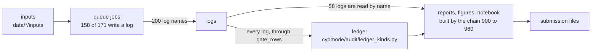

# The flow of the data

The data go one way: the inputs of a track enter the jobs of the queue, the jobs write logs, the ledger reads the lines of the gates in the logs, and the reports, the figures, the notebook and the submission files are built from the logs and the ledger.

A log is named by a module in 58 of the 153 cases in which a job writes it under a fixed name. The others are read through the folder, and 5 modules read every log of it that way:

- `cypmode/audit/method_report.py`
- `cypmode/audit/sections.py`
- `cypmode/audit/sections_extra.py`
- `cypmode/explorer/data.py`
- `notebooks/parts/part06c.py`

The jobs of the chain that run a module of the project (the others run scripts) are:

| job | module it runs |
| --- | --- |
| `905_recompute_paired_summaries` | `cypmode.challenge.recompute_paired_summaries` |
| `906_explorer_bundle` | `cypmode.explorer.data` |
| `910_method_report` | `cypmode.audit.method_report` |
| `921_docs_state` | `cypmode.audit.docs_state` |
| `921_docs_state` | `cypmode.audit.project_map` |
| `925_official_pharmacophore` | `cypmode.validation.official_pharmacophore` |
| `930_public_readiness` | `cypmode.audit.public_readiness` |
| `942_build_notebook` | `notebooks.build_notebook` |
| `947_notebook_public` | `notebooks.build_notebook` |
| `950_submissions_final_sync` | `cypmode.challenge.submissions_sync` |
| `960_pre_submission_gate` | `cypmode.audit.pre_submission` |
