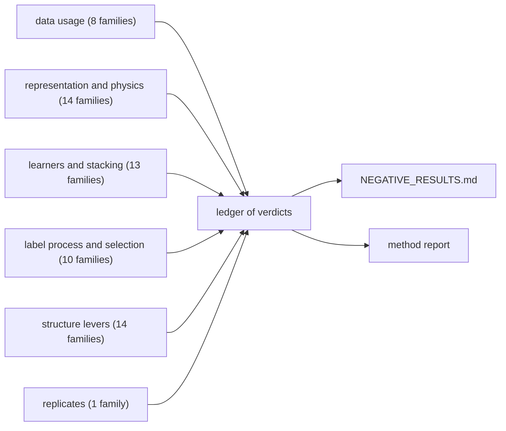

# The evidence

Every idea that the project tried passed through a gate written before its result. A gate prints a line that ends in `MET` or `NOT MET`; the ledger collects those lines from the logs, groups them by the family of the log and by the kind of idea, and counts them. The pattern that finds a gate line is `^(?:STRUCTURE GATE (\w+)[^:\n]*|(CYP\w+) GATE \(([^)]*)\)): (MET|NOT MET)`.

| kind of idea | families | what it tested |
| --- | --- | --- |
| data usage | 8 | the organisers' single-concentration screen and Emax, the PXR induction readings, the NCATS and Tox21 panels, predicted logD and protein binding, the compounds without a direct curve, and the unlabelled test structures as weights |
| representation and physics | 14 | frozen embeddings of pretrained networks (CheMeleon, Monroe, Atom-JEPA), semi-empirical quantum chemistry at four levels, the basic-centre block for CYP2D6 |
| learners and stacking | 13 | tabular foundation models (TabICL, TabPFN, alone and on the embeddings), a multitask network, plain and fine-tuned Chemprop, the OpenADMET pretraining weights, a non-negative blend, and a softmax blend |
| label process and selection | 10 | a model of how the labels came to be (the arms, the gate, the selection-aware CYP2D6 model and its blends), matched molecular pairs, cross-isoform transfer, committees of label models |
| structure levers | 14 | restraint of the iron-nitrogen contact, conformer, seed, template, and step-scale levers, minimum-Bayes-risk and other rules for choosing a pose, a second co-folding engine, expected-improvement sampling, and the heme-frame prior |
| replicates | 1 | the same comparison on ten outer folds for the physics additions and for the neural pair |

The counts of verdicts and of verdicts that were MET are in the method report and in `NEGATIVE_RESULTS.md`; they are read from the logs, which this map does not read.
