# The queue

Every experiment and every build step of the project is a script of `queue/jobs`; the runner (`scripts/queue_runner.sh`) takes them in the order of their numbers. There are 177 jobs in 4 families, by the first digit of the number, and 52 of them wait until every job with a smaller number has finished.

| family | jobs | first | last |
| --- | --- | --- | --- |
| 0xx | 29 | `010_pop_2d6_15fold` | `097_why_no_gain` |
| 1xx | 39 | `100_boltz_unguided_resume` | `199_basic_centre_experiment` |
| 2xx | 86 | `200_permutation_control` | `299_requeue_final_chain` |
| 9xx | 23 | `900_tests_and_audit` | `975_clean_clone_check` |

## The chain that closes the project (23 jobs)

The jobs numbered 900 and above rebuild every report, figure, notebook and submission file from the logs and then check them. The runner takes the jobs in the order of their numbers; an arrow joins two consecutive jobs when the later one also waits, explicitly, for every job before it.

```mermaid
flowchart LR
  j900["900_tests_and_audit"]
  j905["905_recompute_paired_summaries"]
  j906["906_explorer_bundle"]
  j907["907_post_deadline_released"]
  j908["908_post_deadline_tdi"]
  j909["909_post_deadline_structure"]
  j910["910_method_report"]
  j921["921_docs_state"]
  j925["925_official_pharmacophore"]
  j930["930_public_readiness"]
  j940["940_figures_build"]
  j941["941_card_build"]
  j942["942_build_notebook"]
  j943["943_blender_clips"]
  j944["944_pymol_clips"]
  j945["945_video_render"]
  j946["946_interactive_card"]
  j947["947_notebook_public"]
  j950["950_submissions_final_sync"]
  j955["955_final_audit"]
  j960["960_pre_submission_gate"]
  j970["970_data_record_build"]
  j975["975_clean_clone_check"]
  j906 --> j907
  j907 --> j908
  j908 --> j909
  j909 --> j910
  j910 --> j921
  j921 --> j925
  j925 --> j930
  j930 --> j940
  j940 --> j941
  j941 --> j942
  j942 --> j943
  j943 --> j944
  j944 --> j945
  j945 --> j946
  j946 --> j947
  j947 --> j950
  j950 --> j955
  j955 --> j960
  j960 --> j970
  j970 --> j975
```

## Family 0xx (29 jobs)

| job | what it does | waits for |
| --- | --- | --- |
| `010_pop_2d6_15fold` | Selection-aware CYP2D6 (panel-block pool): 3 repeats x 5 folds, the gate for the pre-registered decision. | nothing |
| `012_pop_2d6_sensitivity` | Same caches: sensitivity to the share of non-hits in the scored set. | nothing |
| `013_test_nonhit_share` | Label-shift estimate of how hit-like the blinded test structures are (input to the CYP2D6 A/B decision). | nothing |
| `014_hedged_blend` | Rank blend of hits-only and selection-aware CYP2D6 stacks, judged by the worst case across regimes (cache-only, fast). | nothing |
| `015_pop_3a4_control` | CYP3A4 control: the test is analogs of 3A4 hits, so no selection-aware gain is expected here. | nothing |
| `016_selection_decision` | The decision procedure for the final CYP2D6 entry (cypmode/challenge/selection_decision.py, fixed on 2026-10-25 before any upload): the deployment table of the hits-only file, the selection-aware file and their blend with bootstrap intervals, the evidence on the share of never-promoted compounds in the scored set, and the operating characteristics of reading the live board as a detector of the regime. | nothing |
| `030_calibration` | Runs the calibration experiment (calibration_experiment.py); the log is calibration.log. | nothing |
| `040_selection_aware_v2` | Stronger selection-aware model: cross-isoform hit-profile gate, Heckman-style correction term, gated vs the v1 sets. | nothing |
| `045_block_holdout` | Most test-like validation available: hold out the analog-expansion block of the training ids and score the stack on it. | nothing |
| `046_pair_conditional_transfer` | SAR-aware pair-conditional label transfer (descriptor deltas); the physics-delta variant runs in job 075. | nothing |
| `047_mmp_transfer` | SAR made explicit: matched-molecular-pair transformation features, gated against the base stack. | nothing |
| `050_frozen_embeddings` | Frozen CheMeleon embeddings: chemprop extraction in .venv-ml (no LightGBM), evaluation in .venv (no torch). | nothing |
| `060_test_likeness_training` | Importance-weighted training from the unlabeled test structures; gated alone and stacked. | nothing |
| `070_physics_xtb_block` | GFN2-xTB atom/site/pharmacophore physics block: tblite-only extraction first, then the LightGBM evaluation in separate processes (tblite and LightGBM deadlock in one process). | nothing |
| `071_population_physics` | Physics block inside the selection-aware CYP2D6 model (P(hit) and P(label \| hit)), panel-block pool. | nothing |
| `072_physics_compact` | Compact physics: the 20 most useful physics columns chosen inside every task. | nothing |
| `073_physics_tierb_extract` | Tier-B physics extraction (tblite only, own process): Boltzmann conformers and relaxed hydrogen abstraction. | nothing |
| `074_physics_tierb_experiment` | The tier-B physics block for both isoforms, alone and added to the stack (3 repeats); the gate lines are in physics_tierb_<isoform>.log. | nothing |
| `075_pair_transfer_physics` | Physics-aware SAR: the pair model whose deltas include the xTB block (needs job 070's cache). | nothing |
| `076_xiso_arm_transfer` | Arms of the other isoforms, predicted from structure (cross-fitted), as features of the target-isoform classifier; alone and stacked. | nothing |
| `078_arm_variants` | Floor-clipped two-arm regressors vs the raw-arm ones, alone and stacked. | nothing |
| `080_committee_ei_model` | Probabilistic label-process model: noise-aware committee of two-arm regressors -> P(label) and expected improvement. | nothing |
| `081_replicate_grid_f10` | 10-outer-fold replicate: the default candidate grid on its own plan (outer 10, inner 4, 3 repeats), deployment fits included. | nothing |
| `082_replicate_physics_f10` | The physics comparisons again on the 10-outer-fold plan (tier A, compact, tier B). | nothing |
| `083_replicate_verdict` | The verdict of the 10-outer-fold replicate for both isoforms (replicate_verdict.py), written to replicate_verdict_<isoform>.log. | nothing |
| `084_tdi_stack_reevaluation` | Every comparison that goes through the stack (StackedLogit) again, after its logistic meta-learner was made deterministic (tight tolerance, fixed seed; before, liblinear's random coordinate order changed the stack from process to process). | nothing |
| `090_final_tdi_build` | Gate-driven TDI candidate files, once per design (5 outer folds, then the 10-fold replicate). | every job with a smaller number |
| `096_applicability_domain` | The applicability domain of the 750 blinded compounds, generated from the final build: the reliability of the final stack by nearest-training similarity (held-out outer folds of the nested validation) and the tier of every blinded compound. | every job with a smaller number |
| `097_why_no_gain` | Diagnostics of why each idea that did not join the final stack added nothing: paired change with its corrected p value, redundancy with the final stack, the weight the stack gave it and the smallest effect the nested design could detect. | every job with a smaller number |

## Family 1xx (39 jobs)

| job | what it does | waits for |
| --- | --- | --- |
| `100_boltz_unguided_resume` | Boltz-2 on the ligands of the crystal-anchored benchmark without a restraint (5 diffusion samples each, one sample at a time), resuming after the failed entries are cleared. | nothing |
| `110_boltz_restraint_bond` | Boltz-2 on the benchmark ligands with the iron-nitrogen bond restraint (3 samples each); exits non-zero when a ligand failed, so that the runner tries again. | nothing |
| `120_boltz_restraint_contact` | Boltz-2 on the benchmark ligands with the iron-nitrogen contact restraint (3 samples each); exits non-zero when a ligand failed, so that the runner tries again. | nothing |
| `130_boltz_diversity_pilot` | Boltz-2 on the ligands of the diversity pilot, one sample at a time; exits non-zero when a ligand failed, so that the runner tries again. | nothing |
| `133_series_benchmark_runs` | Boltz-2 on three crystal-anchored analog pairs (6 ligands, 4 samples each): the benchmark of the series-consensus rule. | nothing |
| `135_boltz_cryoem_pilot` | S3: Boltz-2 with the cryo-EM CYP3A4 entries as protein templates, on the three pilot ligands (3 templates each, 1 sample each). | nothing |
| `140_score_restraint_and_pilot` | Scores the poses of the unrestrained, bond-restraint, contact-restraint and diversity-pilot runs on the crystal-anchored benchmark and writes the comparison of the restraints and the pilot report. | nothing |
| `142_series_scoring` | True ligand RMSD of every series pose against its crystal pose. | nothing |
| `144_score_cryoem_pilot` | S3: true ligand RMSD of the cryo-EM template runs, then the pool comparison against the unguided pools (same thresholds as the other pilot levers). | nothing |
| `149_openfold3_memory_probe` | OpenFold3 memory probe. | nothing |
| `150_openfold3_benchmark` | OpenFold3 on the 10 benchmark ligands, 3 samples each, in the memory mode the probe (job 149) found. | nothing |
| `160_score_all_and_report` | Scores every pose of the crystal-anchored benchmark and writes the table of selection outcomes. | nothing |
| `165_structure_gate_verdicts` | Machine-readable restraint and pilot verdicts (STRUCTURE GATE lines) from the scored pose tables of job 140. | nothing |
| `168_pose_awareness` | Physics, molecule and pharmacophore terms of the pose pools, judged on the pooled crystal-anchored benchmark. | nothing |
| `169_series_consensus` | SAR-aware selection: poses that agree with the poses of the ligand's analogs. | nothing |
| `170_mbr_selection_validation` | Validation of the minimum-Bayes-risk selection on the scored benchmark poses (selection_validation.py). | nothing |
| `172_ei_sampling` | Expected-improvement sampling: extra Boltz samples go to the ligands whose pose pool disagrees most (needs the pooled benchmark poses). | every job with a smaller number |
| `173_mbr_lddt_reevaluation` | Minimum Bayes risk and the restraint re-scored with LDDT-PLI against the crystal (exploratory: the registered gate used RMSD). | every job with a smaller number |
| `175_heme_frame_prior` | The heme-frame prior on the scored benchmark poses (heme_frame_prior.py). | nothing |
| `176_restraint_expansion_prepare` | The confirmation of the restraint on crystal ligands that were not used to decide it (plan registered in data/structure_track/inputs/restraint_expansion_plan.json). | every job with a smaller number |
| `177_boltz_restraint_expansion_primary` | Boltz-2 on the primary stratum of the confirmation ligands, both conditions, two samples each (about 13 minutes per sample on this Mac). | every job with a smaller number |
| `178_score_restraint_expansion` | Scores the confirmation runs (RMSD with the existing rescoring harness, LDDT-PLI with lddt_to_crystal) and writes the registered verdicts the final recipe reads. | every job with a smaller number |
| `179_requeue_final_recipe` | Once the restraint confirmation is scored (178), the final recipe and its update (180, 185) must run again so that the structures follow the confirmed (or withdrawn) restraint: their old "done" markers are cleared and the runner, which rescans the jobs after every job, runs them next. | every job with a smaller number |
| `180_structure_final_recipe_run` | Run the frozen recipe on the 20 official ligands and validate every structure. | every job with a smaller number |
| `185_structure_recipe_update` | The final recipe once more after the engine-consensus and selection verdicts exist (jobs 149-170): it reads the verdicts again, adds what they call for to the Boltz runs of job 180 (OpenFold3 samples for the official ligands, MBR or rank-term selection) and rewrites the candidate zip. | every job with a smaller number |
| `186_boltz_restraint_expansion_secondary` | The secondary stratum of the confirmation ligands (31 to 34 heavy atoms): reported next to the primary one, never used for the decision, so it runs after the final recipe. | every job with a smaller number |
| `187_score_restraint_expansion_secondary` | The scoring again with the secondary stratum included (the verdicts of the primary stratum do not change). | every job with a smaller number |
| `188_requeue_final_chain` | After the confirmation, the final recipe and the secondary stratum are finished (180 to 187): the chain that describes and packages the final state runs again, in order, on a quiet repository (audit and tests, paired summaries, method report, public-readiness scan, figures, notebook, the real-structure clips and the film, and the final sync of submissions/). | every job with a smaller number |
| `189_nodirect_labels` | The 1,249 CYP3A4 compounds without a direct curve, used through what their TDI-arm pIC50 implies (194 certain negatives; soft labels for the rest from a first-stage model on the pool rows of each task), alone and inside the stack. | nothing |
| `190_official_extra_audit` | The official files the first release did not read (single-concentration screen, Emax, direct inhibition, reaction phenotyping): identifiers, overlap with the blinded test set, agreement with the TDI file. | nothing |
| `191_basic_centre_extract` | Basic-centre block (Dimorphite-DL protonation states, centre classes, charge-to-ring geometry) for the training and blinded test compounds. | nothing |
| `192_structure_margin_aware_zip` | Margin-aware pose choice: every pool pose is checked with the organisers' own PoseBusters call, the final recipe keeps only valid poses whose relative distance to the receptor is at least 0.80 (the scorer's threshold is 0.75) and rewrites the candidate zip, and the zip is verified the way the scorer reads it. | every job with a smaller number |
| `193_nonneg_stack` | Non-negative stacking as an alternative selector, from the cached predictions of the default stack (same folds, same yardstick). | nothing |
| `194_gate_shift` | The two-part form of the label, P(t > 4.301) x P(t - d > log10 2): the gate reads every compound with a TDI-arm curve. | nothing |
| `195_screen_block` | The official single-concentration screen as a predicted block (cross-fitted inside every task); validated alone and inside the stack, both isoforms. | nothing |
| `196_screen_selection_2d6` | The real screen inside the selection-aware CYP2D6 model (gate learned from the screen; predicted screen in the end-to-end classifier), on the panel-block pool. | nothing |
| `197_emax_block` | The official Emax readings of both arms as a predicted block, validated alone and inside the stack. | nothing |
| `198_mlp_addition` | The multitask network (cache complete) added to the default stack, both isoforms. | nothing |
| `199_basic_centre_experiment` | The basic-centre block added to feature sets A and A+fps, validated alone and inside the stack (it matters most for CYP2D6), both isoforms. | nothing |

## Family 2xx (86 jobs)

| job | what it does | waits for |
| --- | --- | --- |
| `200_permutation_control` | Negative control of the whole nested pipeline: the pool labels are permuted at random and the procedure is repeated; the outer AUC must be 0.5. | nothing |
| `201_tabicl_CYP3A4` | TabICL candidate completed for every task of the nested plan (time-boxed chunks, resumable; the memory guard stays on). | nothing |
| `202_chemeleon_speed` | The speed test and the decision on the fine-tuned CheMeleon (cypmode/challenge/chemeleon_speed.py, decided 2026-10-16 before any measurement): one task that is already in the cache from the processor is trained again on the Apple GPU, in a scratch directory, and the rule of the module decides whether stage 1 for CYP3A4 runs on the GPU, on the processor, or is not run for cost. | nothing |
| `202_tabicl_CYP2D6` | TabICL candidate completed for every task of the nested plan (time-boxed chunks, resumable; the memory guard stays on). | nothing |
| `203_chemprop_CYP3A4` | CheMeleon, stage 1 of its staged design (cypmode/challenge/chemeleon_stage.py): the 25 cross-validation tasks of repeat 0 for CYP3A4, time-boxed chunks, resumable. | nothing |
| `204_chemprop_CYP2D6` | CheMeleon stage 1 for CYP2D6 is not run: the enzyme was dropped from the CheMeleon design on 2026-10-16 (plain Chemprop is at chance on CYP2D6, outer AUC 0.54 and 0.53; the frozen CheMeleon block reaches 0.63; see cypmode/challenge/chemeleon_speed.py). | nothing |
| `205_tabicl_addition` | TabICL added to the default stack once its cache is complete (jobs 201 and 202). | nothing |
| `206_chemprop_addition` | Plain Chemprop (cache complete on the nested plan) added to the default stack, both enzymes; CheMeleon has its own staged jobs (203, 204, 236 to 239). | nothing |
| `207_ost_vs_ours` | OpenStructure's own LDDT-PLI (the organisers' scorer, in the conda environment `ost`) against the local values, pose by pose, on the confirmation ligands. | nothing |
| `208_mlp_aux_CYP3A4` | Multitask network with the official screen and Emax readings as auxiliary heads, completed for every task of the nested plan (time-boxed chunks, resumable). | nothing |
| `209_mlp_aux_CYP2D6` | Multitask network with the official screen and Emax readings as auxiliary heads, completed for every task of the nested plan (time-boxed chunks, resumable). | nothing |
| `210_mlp_aux_addition` | The multitask network with auxiliary heads added to the default stack once its cache is complete (jobs 208 and 209). | nothing |
| `211_monroe_extract` | Frozen Monroe (GRIT) embeddings of the training and blinded test compounds, in the isolated environment .venv-monroe (weights read as plain tensors). | nothing |
| `212_monroe_block_experiment` | The Monroe embedding block added to feature sets A and A+fps (and alone), validated alone and inside the stack, both isoforms. | nothing |
| `213_tabicl_monroe_CYP3A4` | TabICL on the frozen Monroe embedding, completed for every task of the nested plan (time-boxed chunks, resumable). | nothing |
| `214_tabicl_monroe_CYP2D6` | TabICL on the frozen Monroe embedding, completed for every task of the nested plan (time-boxed chunks, resumable). | nothing |
| `215_tabicl_monroe_addition` | TabICL on Monroe embeddings added to the default stack once its cache is complete (jobs 213 and 214). | nothing |
| `217_pxr_block` | The PXR-induction readings of the same compound library (pEC50 and Emax; training set and the two unblinded test phases of the PXR challenge) as a predicted block, alone and inside the stack. | nothing |
| `218_relaxation_gate` | Force-field relaxation of predicted ligand poses in the frozen pocket (OpenMM, in the conda environment openmm), tested on the poses of the crystal-anchored ligands before any use on the official ones: the scorer's PoseBusters verdict and OpenStructure's LDDT-PLI, before and after, with the registered gate of cypmode/validation/relax_gate.py. | nothing |
| `219_ext_cont_extract` | The continuous responses and potencies of the NCATS qHTS panel (PubChem AID 1851) and of the Tox21 CYP screen as label-free blocks: models trained on external compounds only predict them for every challenge compound. | every job with a smaller number |
| `220_ext_cont_experiment` | The continuous external block, and then the Tox21 block as a separate test, added to the feature sets that carry the binary external block, alone and inside the stack (pre-registered gate of addition_experiment), both isoforms. | every job with a smaller number |
| `221_tabpfn_CYP3A4` | TabPFN (Prior Labs) completed for every task of the nested plan (time-boxed chunks, resumable; the memory guard stays on). | nothing |
| `222_tabpfn_CYP2D6` | TabPFN (Prior Labs) completed for every task of the nested plan (time-boxed chunks, resumable; the memory guard stays on). | nothing |
| `223_tabpfn_addition` | TabPFN added to the default stack once its cache is complete (jobs 221 and 222); the pre-registered gate of addition_experiment decides. | nothing |
| `227_openadmet_surrogates` | logD and mouse brain protein binding predicted for every challenge compound by OpenADMET's surrogate Chemprop models (two label-free columns), then the gated test of adding them to feature sets A and A+fps, both isoforms. | every job with a smaller number |
| `228_atomjepa_extract` | Frozen Atom-JEPA embeddings (all 8 blocks, mean over atoms) of every challenge compound, in chunks that are saved as they finish (an interrupted run resumes), then the gated test of adding them to feature sets A and A+fps. | every job with a smaller number |
| `229_atomjepa_head_CYP3A4` | A small attention readout trained on the cached per-atom features of the frozen Atom-JEPA encoder, completed for every task of the nested plan (time-boxed chunks, resumable). | nothing |
| `230_atomjepa_head_CYP2D6` | A small attention readout trained on the cached per-atom features of the frozen Atom-JEPA encoder, completed for every task of the nested plan (time-boxed chunks, resumable). | nothing |
| `231_atomjepa_head_addition` | The Atom-JEPA attention readout added to the default stack once its cache is complete (jobs 229 and 230); the pre-registered gate decides. | nothing |
| `232_neural_f10_fill_CYP3A4` | Confirmatory replicate of the neural pair on CYP3A4 (group neural): plain Chemprop and the multitask network on the 10-outer-fold plan (155 tasks each, deployment fits included), time-boxed chunks, resumable. | nothing |
| `233_neural_addition` | The neural pair (multitask network and plain Chemprop, caches complete) added to the default stack on the nested plan, both enzymes; the ledger rows of the 15-fold design. | nothing |
| `234_neural_addition_f10` | The neural pair on the 10-outer-fold plan (CYP3A4): the confirmatory comparison against the default stack, declared before any 10-fold result existed. | nothing |
| `235_neural_replicate_verdict` | The replicate verdicts again, now with the neural pair (CYP3A4 only; the physics lines are recomputed from the same logs). | nothing |
| `236_chemeleon_stage1_screen` | Stage 1 of CheMeleon: the stacked comparison on repeat 0 (5 outer folds) for CYP3A4. | nothing |
| `237_chemeleon_stage2_CYP3A4` | Stage 2 of CheMeleon (CYP3A4): repeats 1 and 2 and the deployment fits, only if the rule of cypmode/challenge/chemeleon_stage.py asks for it after stage 1; otherwise nothing is run. | nothing |
| `238_chemeleon_stage2_CYP2D6` | Stage 2 of CheMeleon (CYP2D6; the enzyme was dropped from the design on 2026-10-16, so no stage 1 file exists and the rule below always says stop): repeats 1 and 2 and the deployment fits, only if the rule of cypmode/challenge/chemeleon_stage.py asks for it after stage 1; otherwise nothing is run. | nothing |
| `239_chemeleon_addition` | CheMeleon added to the default stack (15 folds, the ordinary gate) for each enzyme whose stage 2 ran; the others stay "screened on 5 folds, not continued". | nothing |
| `240_softmax_selector` | The softmax-temperature selector (T small: the best model, T large: an equal-weight committee) against the logistic blend, from the cached predictions of the default stack; also the exploration-exploitation curve. | nothing |
| `241_ost_regate` | The registered consequence of job 207's verdict: the confirmatory restraint gates repeated with OpenStructure's LDDT-PLI (a few seconds, no model run). | nothing |
| `242_data_checker` | The organisers' data checker (OpenADMET/challenge-data-checker, Apache-2.0, in its own environment .venv-checker with Python 3.12): the official training, Emax and direct-inhibition files against the blinded test file. | nothing |
| `243_structure_relaxation_final` | The force-field relaxation (gate of job 218, MET) applied to the 20 poses of the final recipe under the rule registered in cypmode/validation/relax_final.py, and the final zip rebuilt from the poses that pass it; the candidate zip is checked with the portal's rules and the scorer's own PoseBusters call before it replaces anything, and the recipe's own zip is kept as structures_unrelaxed.zip. | nothing |
| `244_ost_pools_score` | OpenStructure's LDDT-PLI and BiSyRMSD for the 167 poses that the gates of the pools were judged on (about 4 s per pose, measured on three poses), in time-boxed chunks, resumable. | nothing |
| `245_ost_pool_gates` | The gates of the pools repeated on OpenStructure's yardstick (after a check that the same code reproduces every original verdict on unchanged tables); nothing the gates wrote before is touched. | nothing |
| `246_tabicl_chemeleon_CYP3A4` | TabICL on the frozen CheMeleon embedding (128 label-free principal components next to the quantile-transformed descriptors), completed for every task of the nested plan (time-boxed chunks, resumable). | nothing |
| `247_tabicl_chemeleon_CYP2D6` | TabICL on the frozen CheMeleon embedding (128 label-free principal components next to the quantile-transformed descriptors), completed for every task of the nested plan (time-boxed chunks, resumable). | nothing |
| `248_tabicl_chemeleon_addition` | TabICL on the frozen CheMeleon embedding added to the default stack once its cache is complete (jobs 246 and 247); the pre-registered gate of addition_experiment decides. | nothing |
| `249_tabpfn_chemeleon_CYP3A4` | TabPFN on the same frozen CheMeleon representation as job 246/247, completed for every task of the nested plan (time-boxed chunks, resumable; the licence marker of job 221 is needed, see there). | nothing |
| `250_tabpfn_chemeleon_CYP2D6` | TabPFN on the same frozen CheMeleon representation as job 246/247, completed for every task of the nested plan (time-boxed chunks, resumable; the licence marker of job 221 is needed, see there). | nothing |
| `251_tabpfn_chemeleon_addition` | TabPFN on the frozen CheMeleon embedding added to the default stack once its cache is complete (jobs 249 and 250); the pre-registered gate of addition_experiment decides. | nothing |
| `252_atomjepa_head_f10_fill_CYP3A4` | Exploratory replicate of the Atom-JEPA readout on CYP3A4 (declared 2026-10-17, after the registered 5-fold gate was NOT MET): the cached readout completed for every task of the 10-outer-fold plan (time-boxed chunks, resumable). | nothing |
| `253_atomjepa_head_f10_exploratory` | The exploratory comparison of the Atom-JEPA readout with the default stack on the 10-outer-fold plan (CYP3A4 only), declared before any 10-fold number of the readout existed. | nothing |
| `254_all_in_one_comparison` | The all-in-one comparison (cypmode/challenge/all_in_one.py, declared 2026-10-22 before any result): the final stack of each isoform against one stack of every cached candidate, on the experiments' plan, from the prediction caches only (nothing is fitted but the blends). | nothing |
| `255_openadmet_weights_stage1_CYP3A4` | The two OpenADMET pretraining weights (MiniMol embeddings and the Novartis ADMET surrogate predictions as pretraining targets), stage 1 of the two-stage design of chemeleon_stage.py applied unchanged (declared 2026-10-22 before any result): the 25 cross-validation tasks of repeat 0 for CYP3A4 and each of the two starting points, on the device that job 202 decided (mps), in time-boxed chunks, resumable. | nothing |
| `256_openadmet_weights_stage1_screen` | Stage 1 of the OpenADMET pretraining weights: the stacked comparison on repeat 0 (5 outer folds) for CYP3A4, both starting points added to the default stack together. | nothing |
| `257_openadmet_weights_stage2_CYP3A4` | Stage 2 of the OpenADMET pretraining weights (CYP3A4): repeats 1 and 2 and the deployment fits, only if the rule of cypmode/challenge/chemeleon_stage.py asks for it after stage 1 (and it can finish by 2026-10-29); otherwise nothing is run. | nothing |
| `258_openadmet_weights_addition` | The OpenADMET pretraining weights added to the default stack (15 folds, the ordinary gate) for CYP3A4 when stage 2 ran; otherwise they stay "screened on 5 folds, not continued" (or "not run" when job 202 decided so). | nothing |
| `259_bioemu2_probe` | BioEmu2 timing probe in an exclusive window: one benchmark system (CYP3A4, ligand and heme, about 570 tokens), two samples, on the Apple GPU. | `239_chemeleon_addition`, `257_openadmet_weights_stage2_CYP3A4`, `258_openadmet_weights_addition` |
| `260_bioemu2_benchmark` | BioEmu2 on the 10 benchmark ligands, 3 samples each (seeds 0 to 2, the first 256 rows of the alignment of Boltz-2, the Boltz-2 inputs, no contacts), registered on 2026-10-23 before any benchmark ligand was predicted and allowed by the feasibility rule of job 259. | nothing |
| `261_bioemu2_gate` | Scores the BioEmu2 poses of the benchmark against the crystal poses with the yardstick of the other engines and runs the engine-consensus gate registered on 2026-10-23, with BioEmu2 as the added engine; the verdict is the STRUCTURE GATE line of the log. | nothing |
| `262_pocket_pharmacophore_extract` | The pocket-level pharmacophore block (declared on 2026-10-23 before any result): the density fields of the CYP3A4 and CYP2D6 pockets from their public crystal ligands in the frame of the heme, then the 22 columns of every compound of the training and the test file for each pocket (about 0.8 s per compound, four processes), cached once. | nothing |
| `263_pocket_pharmacophore_CYP3A4` | CYP3A4: the gated test of the compound relative to the CYP3A4 pocket (pocket_cyp3a4, the addition), and the control with the pocket of the other enzyme (pocket_cyp2d6 on CYP3A4 data), whose log is not a gate and enters no ledger. 3 repeats of 5 outer folds, the default stack as the base. | nothing |
| `264_pocket_pharmacophore_CYP2D6` | CYP2D6: the gated test of the compound relative to the CYP2D6 pocket (pocket_cyp2d6, the addition), and the control with the pocket of CYP3A4 (pocket_cyp3a4 on CYP2D6 data), whose log is not a gate. | nothing |
| `265_pocket_pharmacophore_replicate` | The replicate rule declared with the pocket block: when the stacked gate of an enzyme's own pocket is MET on 3 repeats of 5 outer folds, the same comparison is made on 10 outer folds and the replicate verdicts are written again (the final build lets the group in only when both are MET). | nothing |
| `266_hypothesis_extract` | The ligand-based pharmacophore hypothesis model (checklist "Pharmacophore modelling", declared on 2026-10-23 before any result): the hypotheses (two- and three-feature pmapper signatures with binned distances over up to 12 conformers) that every compound of the training and the test file realises, kept when at least 10 compounds realise them, cached once as a sparse matrix. | nothing |
| `267_site_model_CYP3A4` | CYP3A4: the gated test of the structure-based site model of the CYP3A4 pocket (site_cyp3a4, the addition), and the control with the site model of the CYP2D6 pocket (site_cyp2d6 on CYP3A4 data), whose log is not a gate and enters no ledger. 3 repeats of 5 outer folds, the default stack as the base. | nothing |
| `268_site_model_CYP2D6` | CYP2D6: the gated test of the structure-based site model of the CYP2D6 pocket (site_cyp2d6, the addition), and the control with the site model of the CYP3A4 pocket (site_cyp3a4 on CYP2D6 data), whose log is not a gate. | nothing |
| `269_hypothesis_model_CYP3A4` | CYP3A4: the gated test of the ligand-based hypothesis model (hypothesis, fitted inside every task on the training rows of the task, out of fold for those rows), and its control, the same model on labels permuted within the training rows (hypothesis_control), whose log is not a gate and enters no ledger. 3 repeats of 5 outer folds, the default stack as the base. | nothing |
| `270_hypothesis_model_CYP2D6` | CYP2D6: the same gated test of the ligand-based hypothesis model, and its permuted-label control (see job 269). | nothing |
| `271_pharmacophore_models_replicate` | The replicate rule declared with the two pharmacophore models: when the stacked gate of a group is MET on 3 repeats of 5 outer folds, the same comparison is made on 10 outer folds and the replicate verdicts are written again (the final build lets the group in only when both are MET). | nothing |
| `272_pose_pharmacophore_gate` | The pharmacophore model of a predicted pose (declared 2026-10-23 before any code), judged on the same pooled crystal-anchored benchmark as the pose terms of job 168_pose_awareness. | nothing |
| `273_conformer_bias` | The check of the conformational bias (declared 2026-10-23 before any code). | nothing |
| `274_site_representation` | The check of the binding-site representation (declared 2026-10-23 before any code): the variability of the pocket among the crystal entries, the pockets of the predicted complexes of the pools of job 272 against it, and the support of the fields. | nothing |
| `275_stereo_official_rerun` | Three official ligands (OCNT-2395415, OCNT-2312554, OCNT-2312966) were first published as racemates and were predicted from the racemic SMILES; the organisers replaced them by the SMILES of the models used for scoring (registered on 2026-10-24 before this job ran). | every job with a smaller number |
| `276_requeue_after_stereo` | After the three official ligands have been predicted again from their corrected SMILES (job 275): the final chain of job 299 runs again from its start. | every job with a smaller number |
| `277_affinity_base_runs` | The affinity step of the three base runs made again from the corrected SMILES (job 275) hit the memory cap of the guards (PYTORCH_MPS_HIGH_WATERMARK_RATIO=1.3: "ran out of memory, skipping batch"), so no affinity file was written and the batch runner recorded the whole row of each of the three ligands as an error (registered on 2026-10-25 before this job ran). | every job with a smaller number |
| `278_requeue_notebook_build` | The first build of the notebook with the sections 9.13 to 9.15, 11.11 and 11.12 (job 942, 2026-10-25, two attempts) stopped at a Markdown cell that writes a number into the text before the cell that computes it (NameError: name 'pocket_sets' is not defined). | every job with a smaller number |
| `279_requeue_notebook_and_film` | The second build of the notebook (job 942, 2026-10-25) stopped at the paragraph of section 12.1 that read a log which the speed test of 2026-10-22 had overwritten; the cell now reads the two records of the speed test, and a collector that ran all the cells found nothing else. | every job with a smaller number |
| `280_requeue_after_wording` | The wording of the project was corrected (no text names a person by a role; cypmode/audit/prose_rules.py, audit section 18, tests/test_prose_rules.py), and two generated documents carried the old words: the method report and the ledger of negative results are generated again here, before the audit, so that the audit and its test suite read the corrected text. | every job with a smaller number |
| `281_requeue_film` | The render of the film (job 945) lost its browser 31 to 33 seconds after every start of the browser and failed in all four attempts of 2026-10-25. | every job with a smaller number |
| `282_requeue_film_again` | The second render of the film (job 945, 2026-10-25) stopped after about 500 frames because another browser, started by a test, used the same debugging port while the render ran and the page of the new browser had no drawing function. | every job with a smaller number |
| `283_requeue_final_sequence` | The order of the final sequence (decided 2026-10-25): the audit twice in a row (job 900), then everything that the audit, the code or the counts of the repository change (the explorer bundle, the method report, the documents, the readiness scan, the notebook, the film, the public edition of the notebook, the files of submissions/), then the audit twice in a row again (job 955), then the gate. | every job with a smaller number |
| `285_label_shift` | An estimate of the positive rate of the scored set that reads no leaderboard (label shift, cross-fitted soft adjusted classify-and-count), compared with the rate of the final build by a rule fixed before the first run. | nothing |
| `286_ligand_dynamics` | Ligand dynamics in the frozen pocket (the rule of docs/structure_track/structure_ligand_dynamics.md, committed before any number): the pools of the static pharmacophore gate, 20 ps of the ligand in its frozen pocket for every pose, the dynamic scores and the gate. | nothing |
| `295_lint_cleanup` | Lint cleanup of the Python modules (decided 2026-10-17). | every job with a smaller number |
| `296_release_unblock` | The release after the deadline: the held-back block is removed, the full card is drawn, one local commit holds what becomes visible, and the final chain 900 to 975 is queued again; it waits for the end of the challenge and for the version of the release. | every job with a smaller number |
| `299_requeue_final_chain` | After the experiments of jobs 190 to 206: the final TDI build reads every gate verdict again (a group whose gate is MET joins the stack), then the chain that describes and packages the final state runs again, in order, on a quiet repository, and the pre-submission gate closes it. | every job with a smaller number |

## Family 9xx (23 jobs)

| job | what it does | waits for |
| --- | --- | --- |
| `900_tests_and_audit` | The first audit of the final sequence: the full audit with the test suite, twice, byte-for-byte; only when every earlier job is finished (a frozen state), the notebook is written and the working tree is committed. | every job with a smaller number |
| `905_recompute_paired_summaries` | Older significance tables re-analysed from their saved per-fold scores with the paired corrected t (no refits). | nothing |
| `906_explorer_bundle` | The data bundle of the interactive explorer (explorer/public): the ledger, the paired comparisons, the selection rules, the benchmark poses, the log excerpts and the out-of-fold predictions of the training compounds, rebuilt from the final logs and caches after the last verdict; the build fails when a table names a blinded compound, mentions a held-back path or has the size of a blinded set. | nothing |
| `907_post_deadline_released` | The files that the organisers released after the deadline (the unblinded TDI test file, the 20 structures, the evaluation code and the Boltz-2 baseline of the tutorial repository at a fixed commit), fetched by name and checked against the SHA-256 values of data/post_deadline/released_manifest.json; the analysis of docs/post_deadline/PLAN.md reads them. | every job with a smaller number |
| `908_post_deadline_tdi` | The questions of the plan of the analysis after the deadline (docs/post_deadline/PLAN.md) about the TDI track: the gate (the scoring of the organisers reproduces the board and names the submitted file), the two candidates, the label rule and the scored set, and the threshold. | every job with a smaller number |
| `909_post_deadline_structure` | The questions of the plan of the analysis after the deadline (docs/post_deadline/PLAN.md) about the structure track: the gate (the scoring of the organisers, run with OpenStructure 2.11.1, reproduces the board), the submitted poses against the published Boltz-2 baseline and the unguided pose, the pool of each compound, and the heme iron. | every job with a smaller number |
| `910_method_report` | Method report and negative-results ledger regenerated from the final logs and audit (job 900 runs first). | every job with a smaller number |
| `921_docs_state` | The generated blocks of README.md and CYPMode_Architecture_Specification.md (the final stack per isoform, the verdicts of the gates, the structure recipe): rewritten from the final build, the logs of the gates and the recipe, then checked against their sources; the pages of docs/map are written and checked with them. | every job with a smaller number |
| `925_official_pharmacophore` | The expected pharmacophore of the 20 official ligands (declared 2026-10-23 before any code), from the final submitted poses and the pools of their valid poses. | every job with a smaller number |
| `930_public_readiness` | Scan for private paths, credentials, foreign e-mail addresses, oversized files; findings go to the log. | every job with a smaller number |
| `940_figures_build` | The illustrations (docs/figures/PLAN.md): every generator, the catalog check, light and dark SVG and PNG, the animations. | every job with a smaller number |
| `941_card_build` | The README card, built after the figures from the final numbers and recorded in audit/artifacts.json (the pre-submission gate checks the record against the numbers). | every job with a smaller number |
| `942_build_notebook` | The notebook (notebooks/PLAN.md): execute every cell against the final files, run the checks (cells, glossary, coverage), write the .ipynb, then the HTML and PDF exports (the build writes them itself when every check passes, so a failed check fails this job). | every job with a smaller number |
| `943_blender_clips` | The cinematic molecule clips of the film (docs/video/STORYBOARD.md): the CYP3A4 enzyme with its heme and a Type II ligand drawn by Blender with the Molecular Nodes add-on from the real coordinates; the film falls back to the PyMOL pictures of job 944 when a clip is missing. | every job with a smaller number |
| `944_pymol_clips` | The real-structure stills and turntables of the film (docs/video/STORYBOARD.md): the heme pocket of CYP3A4 and the pose pools of the official ligands, rendered with PyMOL from the coordinates. | every job with a smaller number |
| `945_video_render` | The animation (docs/video/STORYBOARD.md): every frame drawn by code, encoded to mp4, plus a gif preview and a poster frame. | every job with a smaller number |
| `946_interactive_card` | The interactive card (docs/card/interactive/index.html, one self-contained page with a rotatable structure, the six complexes, the iron-nitrogen distances measured on the loaded coordinates and the numbers of the card), built from the final numbers after the film and recorded in audit/artifacts.json (the pre-submission gate checks the record against the numbers and rebuilds the page to compare it). | every job with a smaller number |
| `947_notebook_public` | The public edition of the notebook (notebooks/public/cypmode_notebook_public.ipynb, .html, .pdf): the same cells run the same way, the outputs and figures that show results for the blinded compounds replaced by a note, built after the complete edition (job 942) from the final numbers; the build fails when a cell still names an official structure ligand or five or more blinded compounds. | every job with a smaller number |
| `950_submissions_final_sync` | The very last job: submissions/ is rewritten from the final TDI candidates and the final structure zip, each checked with the portal's own rules (it never uploads anything). | every job with a smaller number |
| `955_final_audit` | The second audit of the final sequence: the full audit with the test suite, twice, byte-for-byte, on the state that is submitted. | every job with a smaller number |
| `960_pre_submission_gate` | The last gate: whether the queue, the audit, the submission files, the documents, the notebook and the film are finished, consistent and fresh. | every job with a smaller number |
| `970_data_record_build` | The data record: the files that git does not hold, packed into the archives of data_record/record.json next to the repository, with their manifest and lists of paths committed locally; it follows the final chain and the release. | every job with a smaller number |
| `975_clean_clone_check` | One run from a clean clone: the repository is cloned at its last commit, the data record is restored from its archives, the audit is run there and its checks are compared with those of the committed report. | every job with a smaller number |
